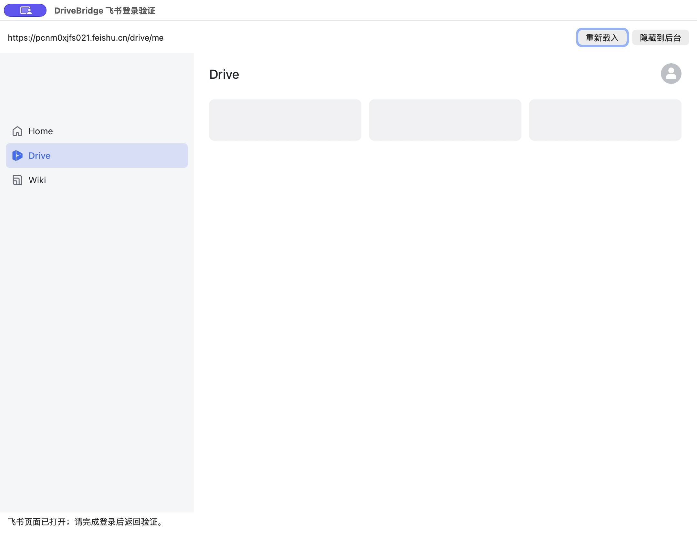

# 应用内登录：macOS 原型验证记录

2026-11-11，macOS 26.5.1 / Apple Silicon，WKWebView。原型以 macOS 14 为编译目标；本轮正式 macOS helper 同样声明最低 14.0。Windows/Linux 当前原生登录不可用，不能从 Go 可编译推断它们已具有登录实现。

**结论：** 当前账号的应用内登录、真实目录读取、隐藏窗口后的读取、进程重启后的会话复用与独立会话存储隔离已通过。本轮没有安装浏览器扩展，没有读取日常浏览器 Cookie。**本记录只证明原型。正式 App 的源码与打包在本轮接入，安装后的产品登录结果另表待填；不宣称已发布或完成三平台验收。**

## 实测结果

| 验证项 | 实际结果 |
| --- | --- |
| 应用内登录 | 原生窗口打开 accounts.feishu.cn 官方登录页，用户亲自完成登录，返回企业云盘 |
| 账号核对 | 使用官方 CLI 根元数据的 user_id 核对本轮个人目录 owner_id，通过 |
| 个人目录 | 3 项，1 页完成 |
| 可见共享 | 3 项，1 页完成 |
| 隐藏共享 | 7 项，1 页完成 |
| 去重入口 | 12 个；13 条来源关系中存在重复资源 |
| 关闭窗口 | Computer Use 点击窗口关闭按钮；进程继续运行，新一轮读取仍完整返回相同清单 |
| 重启登录进程 | 退出旧 helper、启动新 helper，隐藏状态下重新读取，无需再次登录；清单摘要一致 |
| 完整重启验证程序 | 验证控制程序与登录进程均退出并重新启动；再次核对官方身份并读取，仍无需再次登录 |
| 会话存储隔离 | 使用另一随机 UUID 的全新数据存储，结果为需要登录、0 个入口、共享来源未接受任何页面；原会话随后仍能正常读取 |

各阶段有独立扫描时间；重启后的结果不是仅显示旧缓存。清单读取、分页和身份门禁复用了实际 discovery.Scan，未用模拟云端响应。这里验证的是三个目录入口来源，不代表所有子目录已经扫描，也不是服务端对全部可访问共享链接的保证。

## 窗口与界面问题

登录页面可使用，但云盘正文曾空白，重开后仍只显示部分框架和加载骨架。会话内目录接口正常，因此目前可以支持目录发现；不能据此认定整个飞书云盘网页已兼容内嵌展示。正式接入应在账号核对成功后展示本机“登录成功”结果并隐藏登录窗口，不把云盘网页正文作为主管理界面。原型底部仍显示通用登录提示，也是待完善交互，不能当作未登录或已登录的判据。

## 验证边界与后续工作

- 当前仅验证 macOS 当前租户与当前登录流程，未分别测试扫码、企业 SSO、长期过期及系统重启。
- 独立存储隔离通过；尚未验证两个不同真实账号同时完成登录的全部流程。
- Windows WebView2、Linux WebKitGTK 尚未实现或进行原生验证。
- 本轮仅进行只读目录验证，没有操作上传、覆盖、删除、挂载或冲突提交，不能替代主应用端到端同步验收。
- 原型在 ignored 验证目录中运行。其 Bundle ID `org.drivebridge.sessionhost` 在正式 helper 中保持；原型结果不自动证明新安装 App 的 provider、登录入口或账号盘联调已验收。
- 源码编译与验证通道窄范围 race 测试通过。Darwin 链接器有 LC_DYSYMTAB 警告，但测试退出码为 0。

[机器可读证据](evidence/2026-11-11/owned-login-verification.json)只含阶段结果、时间和数量，不包含 Cookie、账号标识、目录 Token 或二维码。原始私有会话由系统 WebView 管理，快照留在私有忽略目录，不提交到仓库。

## 正式 App 接入验收（与原型分开）

正式源码使用 `internal/bridge/ownedlogin` 与 `native/session-host/main.swift`，macOS 载荷为 `libexec/DriveBridge Session.app/Contents/MacOS/drivebridge-session-host`，最低 macOS 14，Bundle ID `org.drivebridge.sessionhost`。下面状态只对应正式产品，不复用上表的原型“通过”。

| 项目 | 当前结果 |
| --- | --- |
| 打包策略与 helper plist/架构/白名单 | 39 项 packaging 单元测试通过；不是实际安装验证 |
| 正式 Swift/helper 与 Go 接入编译、模块测试 | Swift6/macOS14、bridge/cmd cmount+desktop 全块测试、manager/ownedlogin race、后端/VFS 测试通过 |
| 已安装开发载荷打开原生登录并读取真实入口 | 正式 Manager 与 helper 通过：个人3、可见共享3、隐藏共享7，去重12入口；两次新扫描为06:55:04Z、06:59:38Z |
| 关闭窗口继续读取、重启免重复登录 | 隐藏后07:01:06Z新读取通过；Manager/helper整体退出重启后复用通过。已修复初始加载竞态，桌面重启后的首次重新扫描于07:06:33Z通过，无需重新登录 |
| 正式账号隔离、退出清理、升级保留 | Manager.Close后helper退出；最终升级162个受保护文件（含Store数据库）不变，会话复用。双真实账号隔离及原生托盘手动退出未新增实测 |
| 正式账号盘挂载、刷新 | 账号盘运行、队列0/冲突0；真实Finder显示个人/共享/手动分组，共享分组9个规范入口。已重新扫描保留12个入口；本轮未重复云端写入测试 |
| 签名、公证和正式发布 | 未验证，不作发布结论 |
| Windows/Linux 原生登录 | 当前不可用，尚未实现与验收 |

已观察的云盘正文空白/加载骨架仍是兼容边界。正式交互应以本机“登录完成”结果为准，而非承诺整个飞书网页可以内嵌浏览。原型机器证据保持原样，正式验收状态另加记录，不改写历史通过项。

实际截图：[账号盘分组](../../manual/assets/59-owned-account-disk.png)、[原生完成页](../../manual/assets/60-owned-login-complete.png)。自动化终端对新挂载目录的直接 ls 返回 EPERM，Finder 实测可正常展开；未修改系统权限，也不以该 ls 结果声称终端文件访问通过。
