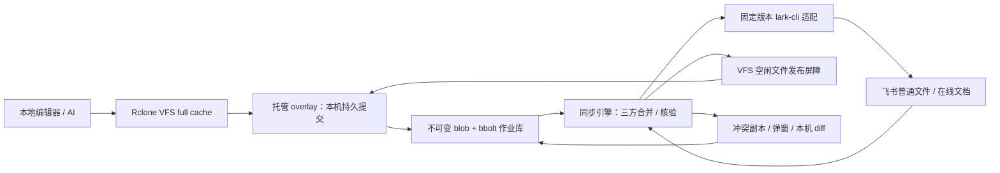

<!-- coding-plan: {"work_id":"feishu-transparent-sync","stage":"design","review_status":"passed"} -->
# DriveBridge 飞书透明同步设计 v1.2

日期：2026-11-10。继承 v1.1 的全部 R-01–R-13 与用户确认，并按[参考审核](audits/2026-11-10-reference-reuse/README.md)修订凭据、操作能力、元数据和分页契约。裁决、任务所有者及未执行的发布验证见 [implementation-decisions.md](implementation-decisions.md)。本文规定目标行为；产品尚未实现，v1.2 独立复核待完成。

## 1. 问题与成功条件

用户或 AI 在本地目录编辑文件，后台负责飞书读写。主流 Markdown 在本地显示为 `.md`，云端对应新版在线文档；普通文件采用覆盖上传。正常保存关闭写入句柄后，后台在数秒内开始同步。出现可检测冲突时，保存双方内容，弹窗并提供三方 diff 人工合并。

每人在自己的电脑上完成首次配置和授权。产品不包含开发者账号、固定共享目录或本机绝对路径。CLI 是管理接口，日常编辑不需要运行命令。

**安全承诺已经用户修订确认：**采用尽力检测、合并及恢复。实测两个文档接口均接受旧版本写入，因此网页端与本地同时修改同一段时仍可能覆盖；不能保证所有冲突都在覆盖前提示。能够读取的历史版本和本地快照辅助恢复，不承诺任意离线时长后的历史都可取得。不得将版本参数、本机锁或写前重读描述成服务端乐观锁。

## 2. 当前实现与证据

工程基线为 `eafd1257d255e00f38aed058eaf24afd2d3cb4f5`。本地 origin 与用户列出的上游不同，实施以当前工作区为准。

| 已有能力 | 位置与结论 |
|---|---|
| Rclone CLI、挂载、RC、Web GUI | `rclone.go`、`cmd/all/all.go`、`cmd/mountlib`、`cmd/gui`；复用，不另建命令框架 |
| 飞书普通文件读写 | `backend/feishu/feishu.go` 已传入 `--file-token`，已经存在覆盖上传 |
| 大小与分页 | 普通对象初始 size 为 0 是缺陷。`+version-history` 的真实样本有效，但 shortcut 丢字段存在性且强制 only_tag，不能保证当前准确大小。首版显式单页 cursor 循环，逐页校验成功后原子替换完整目录快照 |
| 读取方式 | 后端先整文件下载再本地处理 Range；按需访问文件，不承诺远程分块读取 |
| VFS 缓存 | `vfs/vfscache/item.go::_store` 成功后清 Dirty；不能直接将云端合并结果藏在 Update 内而不更新本地内容 |
| 平台包 | 已有 macOS FUSE/NFS 选择、Windows 管理器及 lark-cli/Node.js 打包；需要迁移而非另起一套配置 |
| 实验依赖 | 官方 CLI 1.0.99，macOS arm64；普通文件同 Token 覆盖及 SHA-256 回读一致；Markdown 原样重导入丢失字面 `<tag>`；局部补丁保留测试中的非目标块 |

完整请求、响应和范围见 [validation-results.md](validation-results.md) 与 [manifest](evidence/2026-11-10/manifest.json)。CLI 版本是已验证的初始基线，升级必须重跑契约实验；不是永久版本锁死。

## 3. 功能与验收

| ID | 触发与输入 | 输出、异常与验收 | 来源 |
|---|---|---|---|
| R-01 | 人或 AI 读写本地路径 | 普通编辑器无需插件或手动调用 CLI；本机提交、排队和云端确认有独立状态 | 用户确认 |
| R-02 | Markdown 编辑 | 支持下述语法子集；不支持内容保留原件并阻止破坏性写回，不默默删除 | md 优先；范围为工程决定 |
| R-03 | 协作目录新建 `.md` | 创建在线文档；已有普通 `.md` 维持普通文件身份。既有在线文档投影为 `.md` | 用户确认 |
| R-04 | 本地和远端均变化 | 三方文本/块合并；兼容修改合并；不确定或相互矛盾的修改产生冲突 | 用户确认 |
| R-05 | 其他普通文件保存 | 原 Token 覆盖、回读核验；不做内容合并，不以删旧建新代替覆盖 | 用户确认及实验 |
| R-06 | 检测到冲突 | 持久副本、系统弹窗、本机三方 diff；忽略弹窗不丢内容；单篇暂停，其他文件继续 | 用户确认 |
| R-07 | 句柄关闭、写入稳定 | 默认 2s 后从 VFS 提交至本机队列并开始调度；持续写入或未关闭句柄标记等待，网络/限流无硬实时保证 | 用户接受保存后同步；数值为工程决定 |
| R-08 | 管理账号、映射、挂载、状态 | 保留原生 Rclone 命令，增加 `feishu` 组；三平台可独立 CLI 使用 | 原 v1.0 |
| R-09 | 不同用户、电脑、profile | 配置、凭据引用、队列、缓存和日志隔离；重复显示名不复用错误身份 | 用户确认 |
| R-10 | 网页与本地参与并发 | 明确尽力同步及残余覆盖窗口；不假称原子拒绝；保留已取得的基线及恢复记录 | 用户在实测后确认 |
| R-11 | 离线、权限失效、磁盘满、进程退出 | 保留本机已接收内容；分类阻塞、退避和恢复；不因上传失败或升级清空待上传 | 原 v1.0 |
| R-12 | 创建、改名、移动、删除 | Token/本地稳定 ID 映射；临时文件替换保存不改变既有在线文档身份；删除先备份再调度，根目录禁止删除 | 文件系统完整性要求 |
| R-13 | 三平台安装、升级和卸载 | CLI 全部交付；桌面提醒和合并页可选；更新/默认卸载保留用户数据；实际挂载验证后才标支持 | 原 v1.0 |

### 3.1 Markdown 范围

初始上限为单篇 10 MiB UTF-8。支持段落、标题 1–6、强调/粗体、行内代码、围栏代码块、引用、普通有序/无序列表、链接、分隔线、简单 GFM 表格。列表缩进和代码内容必须保持含义；本地未修改区尽量保持原字节风格，不以全文格式化制造修改。

简单表格按整块合并；双方都改同一表格则转人工，不承诺按单元格自动合并。任务列表、图片/附件、公式、HTML、front matter、Mermaid 和飞书复杂富文本不是首版可任意编辑的承诺：识别后保存原字节或原远端结构，能稳定映射且未修改时原样保留；修改、删除占位或映射不明确时产生 `unsupported_content` 冲突，不静默忽略。

复杂远端块在本地显示为带在线链接的可读占位，机器映射放在侧车状态库。首版不要求用户维护 block ID。新建本地含不支持语法的文件仍持久保存，但进入 blocked 状态，不上传降级后的正文。此边界避免把未知富文本解释为可丢弃内容。

### 3.2 默认值

| 项目 | 默认值和含义 |
|---|---|
| 缓存 | `full`；5 GiB 是可淘汰干净缓存的软预算，不是待上传内容硬上限 |
| 保存调度 | VFS write-back 2s；入队后立即调度；每 profile 最多 2 个网络作业，每 entry 最多 1 个 |
| 远端刷新 | 已访问在线文档 5s；已访问目录 30s；不递归下载整个目录；429 时按服务端要求退避 |
| API 节流 | 每 profile 初始 2 次/秒、突发 2；读取/确定可重试操作最多 5 次，退避 1/2/4/8/16s 加 0–25% 抖动；结果不明确的写入不盲重试 |
| 缓存余量 | 小于 1 GiB 时停止接收额外大快照并报告空间不足；不能删除 pending/conflict/unknown 释放空间 |
| 快照保留 | 冲突、未确认写入和恢复引用无限期保留直至用户明确处理；已确认旧快照保留最近 10 个且至少 30 天，再按引用 GC |
| 停止 | 默认等待 60s；超时返回 `pending_uploads` 并保持工作进程运行，不静默强杀 |

参数是工程默认，可由每个挂载独立调整。没有稳定网络、持续打开的写句柄、限流或超大文件时，不承诺 2–5s 完成上传。

## 4. 架构与责任边界



**选择托管 overlay 的原因：**Rclone 的一次写回只负责把数据可靠交给本机队列。队列中的“已保存”与飞书“已确认”分开；云端合并结果必须经过 VFS 发布屏障才能改变本地视图。不能只在原后端 Update 中修改上传字节，然后让 VFS 保留旧内容并标干净。

托管 overlay 是内部 `fs.Fs` 实例，由产品挂载管理器创建，不注册为普通用户会误用的上传后端。原生 `feishu:`、`copy`、`mount` 等仍走原有直连语义；对普通后端只做大小、分页、错误及只读虚拟文档的安全修复。托管流程不得同时由原后端和同步引擎双重上传。

| 边界 | 责任方 | 负责 | 不负责 | 交接和失败归属 |
|---|---|---|---|---|
| B-01 | `lib/larkcli` | 进程 argv、JSON、错误分类、固定版本 Drive/Docx 适配 | 产品队列、用户文件合并 | 返回结构化结果及 warning；未知结果不转换成成功 |
| B-02 | `backend/feishu` | 原生普通文件 Fs、目录、元数据、同 Token 覆盖 | 托管异步成功状态 | 复用 larkcli；只读 `.url` 不允许 Update/Remove |
| B-03 | `internal/bridge/store` | blob、bbolt、代次、checkpoint、作业及迁移 | 网络、VFS 锁 | blob fsync 后才提交元数据；队列可重启恢复 |
| B-04 | `internal/bridge/overlay` | 托管 `fs.Fs`、名称/Token/entry 映射、本机接受写入 | 直接确认云端成功 | `Update` 成功仅代表本机事务持久；对象大小必须准确 |
| B-05 | `internal/bridge/sync` | 远端刷新、合并、补丁、结果核验、恢复 | 直接重写 VFS 缓存文件 | 网络错误归引擎；本机视图发布只经 B-06 |
| B-06 | `vfs` / `vfscache` 及 mount adapter | 显式启用的空闲发布、句柄计数、干净缓存失效、托管替换保存、可反馈错误的 Flush/Sync | 飞书协议、UI、业务合并 | 打开句柄/Dirty/命名空间操作时外部发布返回 busy；默认原生路径不开启 |
| B-07 | `manager/auth/config/platform` | 每用户配置、授权引导、worker、IPC、系统后台运行 | 存储用户明文密钥到产品配置 | 配置损坏/身份变化拒绝复用队列；权限失效可重新授权续传 |
| B-08 | `conflict/ui` | 副本、通知、三方编辑、版本化提交 | 猜测用户业务意图 | 输入已变化则拒绝提交并刷新，不静默用旧 diff 覆盖 |

## 5. 数据契约

### 5.1 标识与存储

profile、remote、mount、entry、job、conflict 都使用独立 UUID；重命名显示名不改变 ID。云端 Token 是资源身份，不是本地路径。普通文件版本号作为不透明字符串；Docx revision 在 CLI 边界检查为整数，模型统一存字符串。

配置 `schema_version=1`，仅保存 profile 引用、folder token、挂载参数、能力选项和状态路径覆盖。凭据仅由官方 CLI 及当前 OS 用户的系统凭据机制管理，不复制到 `config.json`、日志或安装包。产品 profile UUID 隔离业务状态；CLI auth root 则由已验证身份引用共享，不能用产品配置目录声称凭据强隔离。后台 child process 使用派生 auth root，并清理继承的 CLI 凭据/profile/workspace 覆盖环境；系统网络环境可以保留。

规范配置结构如下，尖括号表示运行时输入，不是默认账号或路径。`identity_hash` 在首次用户身份验证后生成；配置保存时所有 ID 必须为 UUID，引用必须存在。`auth_ref` 是当前 OS 用户私有身份注册表内的相对引用，不能跨用户或由任意路径注入。同 `(AppID, UserOpenID)` 身份必须复用一个 auth root；同 AppID 不同用户必须使用不同 auth root。brand 参与产品身份校验，但官方凭据键不含 brand，不能据此分锁。时长使用 Go duration 字符串，容量使用整数 bytes：

```json
{
  "schema_version": 1,
  "profiles": [{"id":"<profile-uuid>","name":"work","brand":"feishu","auth_ref":"auth/identities/<identity-id>/lark","identity_hash":"<verified-identity-hash>"}],
  "remotes": [{"id":"<remote-uuid>","name":"team","profile_id":"<profile-uuid>","folder_token":"<user-selected-folder>","new_md_policy":"docx"}],
  "mounts": [{"id":"<mount-uuid>","name":"team","remote_id":"<remote-uuid>","mountpoint":"<user-selected-absolute-path-or-drive>","cache_mode":"full","cache_max_bytes":5368709120,"write_back":"2s","poll_docs":"5s","refresh_dirs":"30s","max_doc_bytes":10485760,"notify":true,"autostart":false,"mount_engine":"auto"}]
}
```

可选 `state_dir`/`cache_dir` 为空时使用 DefaultPaths；覆盖路径须预检权限、独占性和挂载递归冲突。产品配置覆盖使用 feishu 组的 `--bridge-config`，不挪用 Rclone 已有 `--config`。

| 数据 | 默认位置 |
|---|---|
| 产品配置 | `os.UserConfigDir()/DriveBridge/config.json` |
| macOS 状态 | 当前用户 Application Support 下的 DriveBridge/State |
| Windows 状态 | 当前用户 Known Folder LocalAppData 下的 DriveBridge/State |
| Linux 状态 | XDG_STATE_HOME/drivebridge，未设置时使用当前用户 `~/.local/state/drivebridge` |
| 状态内容 | `auth/{identities/<identity-id>/lark,locks,registry.json}`、`mounts/<mount-id>/{state.db,blobs,vfs,logs,conflicts}` |
| 可淘汰临时下载 | `os.UserCacheDir()/DriveBridge/Cache/<mount-id>` |

VFS 待写数据放在持久状态目录，不放系统临时目录；配置/缓存目录权限为当前用户私有。Windows 设置等价 ACL。每个 mount 一个 bbolt 库和独占 worker，配置写入另加文件锁；不让多个进程同时写同一库。

### 5.2 核心模型

规范包为 `internal/bridge/model`，其他业务模块只引用这一份类型：

```go
type ProfileID string; type MountID string; type EntryID string
type BlobID string; type SnapshotID string; type JobID string; type ConflictID string
type Kind string // docx | file | folder
type Status string // queued | merging | uploading | awaiting_verification | awaiting_publish | conflict | synced | blocked | paused
type Entry struct {
    ID EntryID; MountID MountID; ProfileID ProfileID
    Remote, CloudName, Token string; Kind Kind; Generation uint64
    Local, Visible, LocalCheckpoint, Desired BlobID
    RemoteCheckpoint SnapshotID; Status Status; FrozenBy string
}
type Snapshot struct {
    ID SnapshotID; Token, Revision string
    XML, Markdown, BlockMap BlobID
    Size int64; ModTime time.Time
}
type Job struct {
    ID JobID; EntryID EntryID; Generation uint64
    Local, BaseLocal, Plan BlobID; BaseRemote SnapshotID
    OperationIDs []string; State Status
}
type Conflict struct {
    ID ConflictID; EntryID EntryID; Generation uint64
    Base, Local, Remote BlobID; RemoteRevision string
    Draft BlobID; Reason string; Resolved bool
}
type NamespaceOp struct {
    ID, Kind, Src, Dst, State string
    SrcID, DstID, ResultID EntryID
    ExpectedSrc, ExpectedDst uint64; DstExists bool
    Input, Previous BlobID // seal 时固定的源/目标快照
}
type CreateOp struct {
    ID string; JobID JobID; EntryID EntryID; Generation uint64
    Kind Kind; ParentToken, TemporaryName, FinalName, Token, Revision string
    Input BlobID; State string // prepared | unknown | bound | finalized
}
```

`Local` 为最新本机已接收快照；`Visible` 为 overlay 当前提供的内容，VFS 尚未落入 overlay 的 Dirty 内容另行计数。`LocalCheckpoint` 为上次确认作业的本地输入；`RemoteCheckpoint` 是实际云端回读，二者可能因自动合并不同。不得只保留一个“基线”并假设它同时代表两端。

blob 按 SHA-256 寻址、不可变；写临时文件→同步文件→原子改名→同步目录→bbolt 事务引用。事务失败留下的无引用 blob 可在 24h 宽限后清理。GC 基于所有 entry/job/conflict/checkpoint/namespace/create/recovery 引用；不能只看文件时间。

## 6. 同步与本地发布

### 6.1 本地保存和远端写回

1. VFS full cache 接受文件操作。托管模式的可反馈确认点是 `Flush/Sync`：同步当前写入序号的数据、范围/Dirty 元数据及目录项；重复 Flush 不重复创建代次。`Release` 仅做最终清理和调度，不能依赖它的错误返回通知编辑器。普通 Close 调用也复用同一持久化协议。
2. 2s 写回触发 overlay Update。读取输入流生成不可变 blob；同一事务将 entry.Generation 加一并入队。返回对象的 Size 对应本地完整字节。
3. 引擎每 entry 串行。准备作业时重新绑定最近确认的双 checkpoint；已有作业正在上传时，新代次保留本地快照并等待，不覆盖作业输入。
4. 获取最新远端结构 R，以本地 checkpoint B、作业输入 L 和 R 做三方合并。只生成有明确块映射的最小补丁；相同改动去重；重叠修改、同位置不同插入、删除对修改、重复块映射歧义均转冲突。代码可逐行合并，表格保守整块处理。
5. 写入前再读目标块并比较哈希/版本；有变化重新规划，连续 3 次漂移则转冲突。此检查不能消除检查后的竞争，遵守 R-10。
6. 为每个操作持久生成本机 Operation.ID，并绑定路线/能力版本。`docs +update` XML 块操作没有 client_token；本机 ID 不提供服务端幂等。仅逐操作验证过的原生 docx 路线可以发送已验证位置的 client_token。首版 ApplyDoc 每次只提交一个逻辑 mutation；T07 在下一操作前持久 RecordOperation 并回读/重建映射，cloud 不做无 journal 的内部批循环。部分成功或响应丢失进入 unknown，先回读并定位已执行效果；结果有歧义则暂停/冲突，不盲重试或整批重放。具体表见 6.4。
7. 回读实际云端结构和内容，保存新的 RemoteCheckpoint。若当前 Generation 已大于作业代次，只确认旧作业，不清除新代次，下一作业以旧输入 L 和实际远端结果重新合并。
8. 仅当前代次仍匹配且 VFS 空闲时发布合并内容；成功后把本地 checkpoint 推进为已发布内容。若新编辑已经开始，保存 Desired 并延期；不得后台改写正在使用的缓存文件。

当远端变化而本地没有待上传内容时，也走步骤 8。Docx/已验证版本路线比较明确 revision；普通文件观测路线比较实际内容 SHA，不把相同内容当相同服务器版本，也不只依赖秒级 mtime/size。打开只读句柄时同样延期更新，避免单次读取跨版本混合。

托管 Item 维护 mutation_seq/durable_seq；WriteAt/Truncate 增加序号，Flush/Sync 在排除在途写入后执行 data fsync→原子元数据替换/fsync→目录 fsync。成功序号之后的写入仍为 dirty。不得只修改 Release 或仅测试 Go Close：`mount2.Flush/Fsync` 已有返回通道，`cmount.Fsync` 当前是 no-op，必须为托管实例转发 handle.Sync。真实挂载需验证 ENOSPC/EIO 经 close/fsync 返回；NFS 未通过等价稳定写入/错误反馈验证时，托管兼容入口只能只读。

普通对象首次访问按需完整物化为不可变本机快照并核验远端版本；同一打开对象后续 Range 读该快照，不在缺块回填时切换为远端另一个版本。列目录只取元数据，不下载所有文件内容。

在线文档转为 Markdown 后的字节大小不能从普通文件 size_bytes 推导。未物化投影对象返回 Size=-1，不冒充空文件；托管 VFS 提供 `ManagedMaterializer.MaterializeManaged(ctx, remote) (fs.Object, error)` 结构接口，目标 Getattr/Lookup（需要大小时）及 Open 在首次返回内核属性前调用，取得准确投影大小。仅 readdir 名称不读取正文。每个 mount adapter 必须接入并传播错误，不能让内核以错误的 0 大小直接 EOF。系统主动逐个 stat 的对象也会触发相应文本投影，这是按客户端访问物化；不做后台递归预取。

### 6.2 VFS 发布接口

在 `vfs/external_update.go` 新增显式启用能力，不依赖内部业务包：

```go
func (v *VFS) EnableManagedSync()
func (v *VFS) TryExternalUpdate(ctx context.Context, remote string,
    commit func() (fs.Object, error)) error
// vfscache：在同一检查中拒绝 Dirty、排队/上传或仍使用中的项
func (c *Cache) InvalidateClean(name string) error
```

实现使用短时 admission reservation：File.Open、各 Handle 的首次 Close/Release、Create/Remove/Rename 进入同一管理器；维护路径/inode 的活动句柄及命名空间操作。更新预留期间阻止新打开或改名；已有任何句柄、Dirty/在途 cache 或命名空间操作时返回 `ErrExternalUpdateBusy`。

预留成功后使干净缓存失效，再调用只做本机 CAS/元数据事务的 commit，更新 File 对象/大小并使目录项失效，最后释放预留。commit 不能访问网络、递归调用 VFS 或删除用户文件。blob 已在进入前准备好。失败或取消释放预留；commit 已成功时必须完成本机对象更新，崩溃后可由持久库恢复。遵守现有 Dir/File/Item 锁顺序，不持 File.mu 调用需 Dir.mu 的方法。

原生挂载未调用 EnableManagedSync，行为与开销保持原路径。托管持久化、替换保存和 admission 不扩散为通用云端业务逻辑。

### 6.3 创建、覆盖、命名和删除

本机路径创建、改名、替换、删除必须通过 Store 的命名空间事务，不能由 overlay 直接改 bbolt bucket。`EnsureEntry` 分配稳定 ID；`PrepareNamespace/SealNamespace/CommitNamespace/FinishNamespace` 覆盖路径索引、代次、tombstone 和 cache/node 发布，重启先重放未完成 namespace，再开放挂载。

云端创建请求发送前，`PrepareCreate` 持久保存 operation UUID、entry/generation、输入 blob、父目录、唯一临时名和最终名。临时名使用 `DriveBridge-pending-<operation UUID>`。在线文档先创建临时空文档再填充；普通文件的首次 upload 本身创建资源，必须直接以临时名上传真实输入字节，不能假设存在“先创建空文件”的接口。取得 Token 后 `BindCreated` 持久绑定，再核验内容、改最终标题并 `FinishCreate`。发送后结果不明确先写 unknown，按父目录/临时名查找并核验；零匹配保持等待、不自动重发，多个匹配暂停；用户显式重试也先核验。只识别本机 journal 的临时资源，不隐藏他人同名前缀文件。

普通文件覆盖已知 Token 前保存当前可取得版本/本地旧快照；上传后下载到临时缓存计算 SHA-256。没有可信远端校验值时使用实际回读，不以大小相同代替内容校验。网络结果不明确进入 awaiting_verification；下载核验确认相同才确认作业，否则展示差异/重试选项，不无条件回滚他人新内容。大文件继续使用 CLI 分片，不能把小文件实验视为大文件通过。

若远端拒绝零字节普通文件，保留本地空文件并进入 blocked/empty_file_unsupported，不把未上传解释为同步成功。修改为非空后正常重新排队；在线文档的空正文按其自身创建契约处理。

名称保守适配 Windows/macOS/Linux：非法字符、控制字符、尾随空格/点及保留设备名做可逆显示编码，literal `%` 也编码。NFC/case-fold 后冲突使用 `~<Token SHA-256 前8位>` 后缀并持久记录；哈希相撞延长至 16 位。既有名称不因其他文件删除而自动改名。新建文件名按用户本地字面输入解释，不盲目解码为远端路径分隔符。

在线标题 `设计` 投影为 `设计.md`；与普通 `设计.md` 冲突也走统一映射。在线文档改名保持 `.md` 和 Token，禁止通过改后缀隐式转换类型。普通资源改为 `.md` 后仍是普通资源；尚未同步的本地新文件最终以 `.md` 保存则创建在线文档。

编辑器 temp→目标的替换保存必须在通用 `operations.Move` **之前**由托管 VFS 分支拦截；通用 Move 会先 Remove 目标，不能仅在 overlay.Move 内补救。托管 Fs 实现以下结构接口（在 vfs 包声明，类型只依赖 fs/标准库）：

```go
type ManagedRenamer interface {
    BeginManagedRename(context.Context, string, string) (string, error) // namespace transaction ID
    RenameManaged(context.Context, string) (fs.Object, error) // sealed transaction ID -> destination
    FinishManagedRename(context.Context, string) error
    AbortManagedRename(context.Context, string) error
}
// vfscache：只向内部 overlay 同步本机保存，不访问云端
func (i *Item) FlushForManagedRename(ctx context.Context, storeFn StoreFn) (fs.Object, error)
```

VFS 对源/目标取得命名空间预留；存在活动写句柄时返回 busy 且保持两边内容。**在 Flush 之前**调用 BeginManagedRename/PrepareNamespace，事务冻结两条路径及 entry 调度。Store.Prepare(job) 与冻结检查在同一事务内：被 FrozenBy 标记的 entry 不得开始新网络作业。这里 inflight 包含 Prepare 已取得执行权的 merging/uploading 作业。源已有 inflight、awaiting_verification 或未核验 CreateOp 时 Begin 返回 ErrNamespaceBusy，先完成/核验该作业，不取消后盲目创建；目标已有在途作业可以完成确认，但不得开始下一作业，仍按旧代次确认规则处理。

冻结后将两边尚未落入 overlay 的 Dirty cache 同步提交本机快照，保留目标旧代次；此阶段 Stage 只接收本机内容并维持冻结，不能触发网络调度。RenameManaged 先 SealNamespace 固定本次源/目标快照及代次，sealed 后拒绝新的 Stage，再 CommitNamespace 保持目标 ID/Token/基线并接收源内容为新代次。源尚无 fs.Object 的分支也走此路径。更新 cache/node 后 Finish 才解冻并调度目标；源未开始的作业取消/合并，不创建临时源资源。已有远端源的清理仅在目标新代次云端确认后调度，保留恢复引用，不删除目标。

准备阶段失败用 AbortManagedRename 解冻且保留内容；commit 后失败不按 abort 回滚假装没发生，保留 journal，在挂载重开前完成本机 namespace 发布，再 Finish。此过程允许必要的本机 blob 复制，不执行云端操作，不直接重新上传旧临时路径。重启先处理 prepared/sealed/committed 的冻结记录，再允许引擎 Prepare，避免源路径作业抢先上传。

普通非覆盖改名也走该事务。原生非托管模式保持通用 Move。短生命周期临时文件不上传；`.DS_Store`、`Thumbs.db`、`*.swp`、`*.swo`、`.~*` 默认只保留本地，过滤列表可配置，不笼统排除所有 `.tmp`。

显式删除先保存可读取的快照并入 tombstone 作业，保留 30 天的本地恢复记录；删除与编辑并发则冲突。已确认删除不自动递归恢复整个目录；用户可从恢复页另存。根目录禁止删除，非空目录拒绝 Rmdir。原生只读 `.url` 入口不允许借 Remove 删除在线原件。

### 6.4 操作路线与能力门槛

路线按固定 CLI 版本和每种操作分别验证；通用 `ApplyDoc` 签名不代表所有路线可用。能力默认关闭或 unknown，T02 提供实测/离线证据标记，T07 在提交前检查。能力失败仅阻止受影响操作，保留本机数据，其他已验证任务可继续实施。revision、重读和本机锁均不提供服务端 CAS 或 exactly-once。

| Operation.Kind | 首版路线 / 必需能力 | 服务端幂等 | unknown 回读裁决 |
|---|---|---|---|
| block_replace | `docs +update --doc-format xml --command block_replace`；唯一目标/范围及非目标保真验证 | 无 client_token | 回读目标与上下文，唯一匹配预期效果才记完成；仍等于旧值也须排除并发/异步未完成，不能据此盲重试；歧义冲突 |
| block_delete | 同 shortcut `block_delete`；范围/边界验证 | 无 client_token | 目标缺失且锚点/内容唯一吻合才能判已执行；重排或同时删除导致歧义则暂停 |
| block_insert_after | 同 shortcut `block_insert_after`；唯一锚点/插入定位验证 | 无 client_token | 锚点和新块内容唯一吻合才完成；重复内容或无法区分他人插入则暂停，不重复插入 |
| append | 映射为上述 insert，锚点为末尾；仅经验证时启用 | 无 client_token | 按插入规则核验，末尾重复内容转冲突 |
| copy/move/str_replace/overwrite | 首版不用于自动合并；不能以整篇 overwrite 兜底 | 不推定 | unsupported_capability，保留本地输入 |
| 新建文档 / 普通文件首次上传 | `docs +create` / `drive +upload` 的 T02 typed 路线与持久 CreateOp 唯一临时名 | 不推定 | 按父目录、临时名、类型及可核验输入定位，唯一后绑定 Token；多/零且不能确定则暂停 |
| 普通文件覆盖、改名、移动、删除 | T02 固定 Drive typed 路线；同 Token/备份/回读能力 | 不推定 | 按稳定 Token、版本与内容核验；缺可证明证据则 unknown，删除不因目录部分列表而成立 |
| 原生 `/open-apis/docx/v1/...` 块 API 候选 | 每个方法分别验证 payload、块类型转换、参数位置和响应；不自动从 docs_ai fallback | 仅该方法 schema 和实验确认的字段/重放范围有效 | 未验证一律关闭；即使带 client_token 仍需 journal/回读，不能宣称 CAS 或 exactly-once |

### 6.5 精确元数据与完整目录

普通文件分服务器版本与下载观测两条路线，完整规范见 [file-observation-contract.md](file-observation-contract.md)。服务器版本保持严格证明门槛；传输完成的普通文件观测按实际字节/哈希持久采用，不伪造 Version 或 Revision。缺少 current-version 关联不阻止观测型读取。以下历史/版本条件仅约束服务器版本路线。

普通文件元数据候选为官方 raw `api GET /open-apis/drive/v1/files/{token}/history`，JSON 原始 items 字段，单页请求参数明确 `only_tag=false`、`page_size` 和后续 `last_edit_time`。这是保留 presence 的候选，不声称服务端接受该过滤或排序/最新语义已验证。T02 使用 `json.RawMessage`/`json.Number` 和带 presence 的 DTO，逐项检查 version、size、类型、删除状态和时间；负数、非整数、溢出、缺字段/非法字段返回协议/metadata_unknown 错误，不能负转零或缺转空。真实空文件只有明确 size=0 且完整验证后才成立。

只有另一个已验证当前版本来源与 history version 明确关联，且证明该条 size 属于该版本时，才返回当前 FileMeta。`limit 1`、最大数值、首条、mtime 或 only_tag 结果都不能独立证明 head。T02 必须记录当前版本来源/关联的证据；尚无证明时，只允许对已知且已验证版本执行完整 `+version-get --version V` 下载、确认服务端确实按 V 返回不可变字节及完整性后计数字节，元数据绑定 V（`+version-get` 响应 version 只是请求回显，不能单独证明版本遵循）；若不能证明 V 为当前，FileMeta 不得冒充 current，返回 metadata_unknown；采用独立 ObserveFile 路线时，以已持久绑定观测字节提供准确本地大小/读取，不冒充服务器版本。无可靠 mtime 时可用持久首次观测值并标明来源；不能用空字符串伪造版本。能力不足不阻止无网络的配置/存储/codec 等任务开发。

首版列表只用显式单页 cursor 循环，禁用 `--page-all`。每页独立验证进程结果、typed JSON envelope、业务 code、items 类型、has_more 布尔及下一 cursor。has_more=true 时 cursor 必须非空且未出现（包括与本页输入相同）；缺字段/重复 cursor/网络失败/取消/后续业务错误均使刷新失败。仅最终有效 has_more=false 后，将暂存条目原子替换为新的完整 namespace snapshot。任一页失败保留之前完整快照并报告错误；首次没有完整快照则返回不可用，不以部分列表推断删除或空目录。聚合 ok/exit=0/has_more=false 不能证明完整性。

## 7. 配置、管理与 UI

### 7.1 初次配置和身份隔离

桌面入口引导创建/绑定该用户自己的应用配置、浏览器授权、选共享目录及挂载点；复用官方 config init/auth device flow。CLI 提供同等能力。产品 profile 与实际 CLI 凭据域分开：首次应用配置使用受控 enrollment 子进程和临时私有 auth root（见下述协议），授权校验后由身份注册表在锁内绑定/复用 canonical root；相同身份重复引用共享一个 root 和 coordinator，同 AppID 不同用户保留不同 root。临时 root 的配置归并由官方命令受控完成，产品不读取/复制密钥。系统后台进程接收绝对可执行文件位置和派生配置目录，不依赖交互 shell 的 PATH。

保存身份绑定摘要 `(brand, app_id, user_open_id)`；重新授权后身份不符时暂停旧队列，要求显式创建新 profile 或迁移，不能拿同名账号继续上传。最终 granted scope 可能多于 requested，展示飞书实际授权状态；权限不足按响应提示恢复，不自动请求全域权限。解除单个 profile 引用不等于执行官方 logout。logout/重授权/改应用密钥须检查同身份及同 AppID 的所有引用；存在使用中的挂载或未确认作业时拒绝破坏性生命周期操作并提供停止/保留入口。

凭据锁位于当前 OS 用户私有 state 下，按官方实际域命名：AppID 级 App Secret/TAT、AppID+UserOpenID 级 UAT；均不含 brand。所有产品托管子进程先取得当前 OS 用户 enrollment gate（正常已知应用共享，未知 AppID 注册独占），再按 AppID、可选 AppID+OpenID 的顺序加锁。首版保守地按 AppID 独占串行所有可能访问凭据/自动刷新的 child invocation，再按 AppID+UserOpenID 加身份锁（未知用户只取应用锁），全程固定 gate→AppID→身份的顺序且支持取消。锁覆盖整个 child 生命周期及其配置副作用，所有托管 worker/config/auth 共用；不只锁 login。CLI 内部 configDir/locks 不能替代这个跨 root 文件锁；不同 OS 用户仍由系统权限隔离。此策略牺牲同 AppID 不同用户的网络并发，profile 并发上限不绕过它。

Runner 使用明确的系统/网络环境允许集合，删除官方 credential extension/env provider、CLI profile/config/data/workspace 等覆盖来源，再注入受控路径和 `--as user`；具体固定版本变量清单及未知新变量的拒绝策略由 T02 契约夹具维护。配置 auth 字段只含引用和已验证身份，不含 secret/token/device_code。原生 `feishu:` 直连保持原有 CLI 配置及官方锁，不自动迁移到产品身份注册表、不要求产品登录，也不自动共享 canonical auth root。共享 Runner 必须显式区分 legacy/direct 与 managed 模式：managed（包括 worker 内部若复用原生适配）缺身份/协调器即拒绝运行，不得降级 direct；direct 的 CLI 凭据生命周期视同外部独立 CLI，不受产品锁约束。外部独立 CLI/legacy direct 不参与产品锁，不能保证其刷新/logout/换账号安全；检测到身份变化、凭据撤销或异常轮换即暂停关联队列，要求显式重授权、身份复验及 unknown 核验后恢复，不能自动改绑旧队列。

### 7.1.1 首次应用配置与用户授权子进程

`auth.Start(profile)` 根据状态返回 Kind=`app_config` 或 `user_auth`；`Complete(flowID)` 仅收割同一保留子进程，不重新提交秘密。UI 不要求用户手工运行 CLI。应用尚未配置时，T08 通过 T02 显式 Enrollment 方法运行 `config init --new --brand feishu|lark`；此命令可非 TTY 运行但会阻塞，无 `--json`/`--no-wait`。T02 流式读取 stderr 的 URL/QR/prose，使用固定版本夹具提取校验后的官方注册 URL；仅将 URL/状态返回 UI，原文不落日志。stdout 最终裸 JSON 中的 appId/brand 可白名单解析，不读取 appSecret（该输出为掩码）。注册 AppID 在完成前未知，因此持 OS 用户全局 enrollment gate 独占，全部其他托管 child 在 gate 共享侧等待；独立 CLI/direct 仍在锁外。一般 managed 业务调用必须有已验证身份，只有显式 enrollment/auth 方法允许当前阶段身份缺失，不能成为任意无锁调用入口。

配置输出出现不等于成功：CLI 可能先保存并输出后 probe 失败。T08 收集最终退出码和脱敏状态，重新以安全元数据来源校验配置/应用身份；只有核验通过才绑定已知 AppID、切到 gate→AppID 协调并进入用户授权。取消/超时必须先终止并 reap child 再释放锁；注册可能已创建远端应用/本机配置，保留 enrollment 引用并标记待核验，不删除 shared keychain、不假设回滚成功。注册无已知服务端 expiry 输出，AuthFlow.ExpiresAt 保持零值/未知，另记录明确的本机等待上限（默认 10 分钟）及取消状态；重启先核验残留状态再重试注册，不恢复已丢失的内存流程。

用户授权采用保留流式进程 `auth login --scope <明确需要的scopes> --json`（该命令不加 `--as`），避免 split completion 的 `--device-code` 只能经 argv 传递问题。T02 解析裸 NDJSON 事件：`device_authorization` 的 verification_uri/verification_uri_complete、user_code、expires_in；`authorization_complete` 的 user_open_id、实际 scope/granted/missing 与 expires_at 等白名单字段。事件没有通用 ok/success 字段。Start 在收到有效 URL 事件后返回，T08 在私有内存保留 child/锁/flow，Complete 等待同一进程完成并核验最终身份/实际 scopes。没有 URL、输出形状变化或退出失败即明确失败；missing scope 可能在存凭据后发事件并非零退出，不能只看完成事件判成功。只有成功退出、身份核验及必需 scopes 齐全才启用同步。过期、取消或重启后释放已 reap 的 child/锁；未收割成功的凭据/配置以 unknown 恢复核验，不盲发新登录覆盖身份。产品配置、日志、浏览器都不接收 device_code/token/secret；显式 AppSecret 配置若后续启用只允许官方 `--app-secret-stdin`，不放 argv，不是首版自动注册的前提。

### 7.2 管理命令

保留原命令；新增 `drivebridge feishu`，命令组包括 doctor、account、remote、mount、upload、conflict、cache、logs、completion。只在后台 worker 中创建托管 Fs；一个 mount 一个 worker。

```text
feishu doctor [--profile NAME] [--json]
feishu account login|status|logout --profile NAME [--json]
feishu remote add NAME --profile NAME --folder-token TOKEN
feishu remote test|list|remove [NAME] [--json]
feishu mount add NAME --remote NAME --mountpoint PATH [--cache-mode full] [--cache-size 5G] [--write-back 2s]
feishu mount start NAME [--background] [--wait 30s]
feishu mount status [NAME] [--json]
feishu mount stop NAME [--wait-upload 60s]
feishu upload status|retry NAME [--json]
feishu conflict list NAME [--json]
feishu conflict open ID
feishu conflict resolve ID --file PATH --expected-generation N --expected-remote-revision REV
feishu cache status|clean NAME [--json]
feishu logs NAME [--follow] [--json]
feishu completion bash|zsh|fish|powershell
feishu gui [--no-open-browser]
feishu mount enable-autostart|disable-autostart NAME
```

内部 worker 入口隐藏于帮助，携带 mount UUID，不传密钥。CLI 与 GUI 通过本机认证 IPC 访问同一 worker。IPC 文件包含端口、PID、启动实例 UUID 和私有认证引用；检查 PID 复用及实例握手。只绑定 loopback，不启用 `--rc-no-auth`。状态 JSON 使用 `schema_version:1`，同时输出 `local_saved`、`vfs_pending`、`cloud_state`、`queued`、`inflight`、`conflicts`、`last_error`；不要用单个 running 表示同步成功。

`feishu gui` 是每用户 UI host，桌面快捷方式直接启动它。无挂载时它可操作 config/auth，完成首次使用；有挂载时仅经 IPC 转发状态和冲突请求，不直接写 worker 的数据库。关闭 host 不停止挂载。Windows worker/登录任务运行在该用户交互会话而非 SYSTEM/session 0，避免盘符和凭据不可见；macOS 使用该用户 LaunchAgent。

退出码：0 成功；2 参数/配置；3 未授权；4 驱动或能力不足；5 网络暂不可用；6 待上传/冲突阻止操作；7 身份/版本已变化；1 其他错误。JSON 错误含稳定 code、retryable 和脱敏 message，stdout 不混进日志。

### 7.3 冲突界面

默认系统弹窗去重提示并自动打开一次本机合并页；同一冲突的新远端版本更新计数，不反复抢焦点。合并页显示共同原版、本地、云端和可编辑结果，提供逐差异选择、保存草稿、稍后处理和提交。关闭页面保留所有引用，不影响其他文件。

结果提交附带 conflict ID、local generation、remote revision 和目标 entry ID。后台重新读取并检查；任一输入变化返回 409/version_changed，保存草稿并重新生成 diff。通过检查后仍遵守 R-10，不宣称服务端原子保护。离线可保存草稿，在线复核后提交。

实现采用 Go 内嵌静态 HTML/CSS/JS 与服务器生成的 diff hunks，不要求外装编辑器、不从 CDN 加载。正文只显示转义纯文本，不执行 Markdown/HTML。UI 服务只绑定 loopback；一次性 fragment 引导建立 HttpOnly/SameSite 会话，校验 Host/Origin、防 CSRF/路径穿越，不把飞书凭据交给浏览器。无桌面环境保留冲突、状态和 CLI resolve；不因通知失败丢内容。

## 8. 三平台交付与迁移

| 平台 | 首选挂载及后台 | 安装产物与发布条件 |
|---|---|---|
| macOS amd64/arm64 | `cmount`/macFUSE，launchd 用户 agent；NFS 为 experimental，未证明稳定写入错误反馈时托管只读 | pkg、dmg、tar.gz；本机 SDK 构建，真实驱动测试；签名/公证凭据缺失只能产出标明未签名的测试包 |
| Windows x64 | `cmount`/WinFsp；独立后台进程，登录启动使用用户计划任务 | msi、安装 exe、zip；保留内置 lark-cli/Node.js；验证普通用户盘符和退出/升级 |
| Linux amd64/arm64 | `mount2`、可用 `/dev/fuse` 与 FUSE3 工具；systemd --user | deb、rpm、tar.gz；两个架构实际挂载测试，不用交叉编译冒充运行通过 |

后台统一自行启动 worker，不对 Windows 传 `mount --daemon`。选择挂载引擎时检查编译可用性；缺少驱动明确报错，不自动提权。FUSE-T 只有单独完成验收后才标支持。

升级：停止接收配置变更→安全停止工作进程→备份配置/库→事务迁移→校验 blob 引用→重放未完成作业→恢复挂载。新版本不能原地覆盖仍运行的 worker。旧二进制遇到未来 schema 只读退出，不反向覆盖数据库。默认卸载保留状态、凭据及未上传数据，清除用户数据是独立明确操作。

旧 macOS/Windows 脚本配置提供显式 import，先预览远端、路径、身份引用和目录冲突；不直接执行导入配置中的命令或自动删除旧缓存。导入完成后旧启动项停用，防止两个管理器同时挂载同一目标。既有 Rclone 配置默认只读引用或生成独立快照，不改其他 remotes。

## 9. 验收与真实验证条件

已执行的只有接口报告及大小元数据探测。以下是实施和发布必须执行的检查，不能标成当前已经通过：

- 核心状态：写入 g2 时 g1 上传完成不清掉 g2；部分成功不重复插入；未知结果不重复创建；磁盘满不删除引用数据。
- 文档保真：正文 `<tag>`、反斜线、代码块、中文、列表、表格、重复段落、块重排、复杂占位；不支持语法阻止降级写回。
- 文件系统：truncate→多次写、temp rename 覆盖、并发打开/关闭、相同文件两个句柄、目录改名；远端刷新遇 Dirty 或只读句柄也必须延期。
- 合并：兼容修改去重，同段冲突、删除对编辑、表格双改、映射歧义；保存 diff 草稿后两端再次变化返回 409。
- 恢复：在 blob fsync、元数据提交、上传发送、响应收到、远端核验和本机发布各点注入退出；重启不丢本机已接收内容。
- 隔离：两台电脑和两个系统用户分别配置；同名 profile 不串凭据、缓存或队列；重授权为另一人时暂停而非重用。
- 跨平台：每个发布 OS/架构用实际挂载点执行创建、读写、改名、停止；桌面弹窗/合并页及无桌面模式分别验收。
- 升级：保留 pending/conflict 数据迁移、回滚只读行为、未关闭句柄停止超时、卸载保留数据。
- 真实接口：固定 CLI 契约、小/大/空文件、权限撤销、分页、多种富文本、429 和结果不明确；历史不可取得时准确降级，不承诺恢复。

## 10. 决定、关卡和复核

用户决定：透明文件操作、md 优先、新 md→在线文档、普通文件覆盖、冲突弹窗与 diff、保存后同步、每用户独立配置、接受尽力同步的残余并发风险。

工程决定：内部 overlay、双 checkpoint、空闲发布屏障、bbolt/blob、语法子集和 10 MiB 限制、2s/5s/30s 默认值、Go 内嵌本机合并页、保守冲突策略、唯一临时创建标识、状态迁移流程。不是用户原话，交付时供审阅。

v1.1 的 95/100 与独立复核仅是历史记录，见 [review.md](review.md)。v1.2 重评外部能力与验证缺口，不沿用 ready；当前门槛和证据见 [readiness.json](readiness.json)，独立复核 pending。用户已授权按任务实施；本次修订只闭合文档决定，不把能力候选或模拟测试当成真实通过。不得自动创建 Goal、安装驱动、推送或发布。
