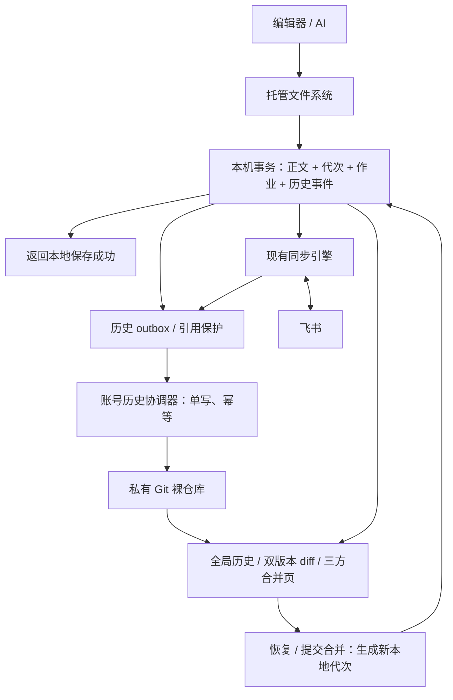

<!-- coding-plan: {"work_id":"global-git-history","stage":"design","review_status":"passed"} -->
# DriveBridge 全局 Git 文件历史设计 v1.1

日期：2026-11-12。状态：按用户要求自审修订，尚未实施 Git 历史功能。v1.0 自审前 SHA-256 为 `2b2bc5da19a303ec65ea3229181f6117dba432df48bd6e0b5837d147b4167b62`。本文沿用飞书透明同步、按需缓存及本机优先保存的既有要求。

## 1. 用户目标与设计结论

用户或 AI 继续直接编辑挂载盘，后台自动记录文件变化。管理页面统一展示修改历史、差异、同步结果及恢复入口。比较和人工合并不在用户目录生成 `base/local/remote`、冲突副本或带时间戳的额外文件。

采用「现有本机事务库 + 每账号私有 Git 裸仓库 + 统一历史界面」。Git 覆盖一个账号下的个人、共享、手动添加目录和所有挂载映射；应用界面聚合多个账号，但物理仓库、权限和清理彼此隔离。每台电脑独立建立历史，不默认向任何 Git 服务器推送。

“全局”有两项明确边界：

- 所有已发现文件都可记录名称、位置、类型、Token、已观察到的版本；未取得的正文标记为未缓存，不为建库下载全盘。
- 本地持久保存的版本、实际取得的云端版本可以记录正文；不保证获得应用未运行、未读取期间的所有飞书历史，也不推断未知操作者身份。

Git 是历史与差异层；本机事务、待上传队列、云端核验和富文档转换继续由已有模块负责。

## 2. 当前实现与事实依据

| 已有能力 | 源码依据 | 本次处理 |
|---|---|---|
| 本机不可变正文与作业 | `internal/bridge/store/jobs.go`：`Stage`、`stageBlob`，保留 EntryID、Generation、BaseLocal、BaseRemote | 复用，在同一事务加入历史 outbox |
| 保存时持久提交 | `vfs/read_write.go`：托管 `Flush`、`Sync` 调用 `FlushManaged`；`overlay/object.go` 导入 blob 后 Stage | 在已接受完整正文的边界发事件，不依赖目录 watcher 反复读文件 |
| 云端快照和图片映射 | `model.Snapshot`、`store/snapshots.go`、`DocMedia` | 把正文、投影来源及资源清单交给历史层 |
| 三方冲突和草稿 | `model.Conflict`、`store/conflicts.go`、`manager/conflicts.go` | 直接读取基线/本地/云端的内部 blob，无须导出比较文件 |
| 显式冲突副本导出 | `store/conflict_copies.go` | 保留为用户主动导出能力，默认历史与 diff 不调用此入口 |
| 快照回收 | `store/gc.go`、`store/cache_eviction.go` | 接入历史引用，避免正文或图片被普通缓存清理误删 |
| 编辑器备份改名 | `model/editor.go`、`store/safe_save.go`、`overlay/namespace.go` | 延续稳定身份；备份不成为新的云端文档或独立历史主体 |

现有 Store 有恢复数据，但不是完整的面向用户的历史服务。不能仅把当前快照列表改名为 Git 历史；需要补齐持久事件、引用保护、索引和恢复契约。

Git 官方接口支持从标准输入写内容、构造提交、安全更新引用、按对象读取正文并比较版本。macOS 本机隔离探针已验证这些基础组合，尚不代表应用集成、断电恢复和 Windows/Linux 运行验证完成。

## 3. 功能需求与验收对应

| ID | 触发与输入 | 输出和异常 | 验收 |
|---|---|---|---|
| GH-01 | 发现目录或新增映射 | 全局文件索引及已知元数据；无正文时明确未知 | 冷文件不下载，所有账号/目录可筛选 |
| GH-02 | 本地持久提交检查点被接受 | 该时点一致的正文、代次、历史事件；异步提交 Git | 断网正常保存，Git 慢不延迟保存等待；不宣称能判断应用语义上的编辑完成 |
| GH-03 | 真正新增、改名、移动、删除 | 关联稳定身份的操作历史 | 改名不断历史；同名重建不错误合并身份 |
| GH-04 | 观察到新的云端正文或版本 | 记录观察时间、远端版本及可用正文 | 不误标成本地编辑，不伪造完整云端审计 |
| GH-05 | 用户选择版本或待同步文件 | 双版本 diff、三方比较、资源预览 | 无用户目录比较副本；缺正文不呈现为空文件 |
| GH-06 | 本地与云端并发变化 | 按既有规则自动合并或人工处理，记录输入与结果 | 本地新内容不被旧快照还原；冲突不修改原文插入标记 |
| GH-07 | 恢复旧版或已删文件 | 新本地代次、新历史事件、正常同步任务 | 恢复前校验当前代次；不直接重置整个云盘 |
| GH-08 | Git 不可用、进程崩溃、磁盘不足 | 本地保存/历史/云端三个独立状态及可操作错误 | 已接收正文和待归档引用不丢；本机落盘失败返回真实错误 |
| GH-09 | 缓存淘汰、历史保留期、移除挂载 | 正确区分缓存、历史、待上传及移除映射 | 清理缓存不破坏保留版本；移除映射不等于云端删除 |
| GH-10 | 三平台安装、升级和多实例 | 自动提供 Git 运行时、数据隔离、单写与兼容迁移 | 用户无需手动装 Git；三平台分别通过实测后宣称支持 |

## 4. 总体架构与职责



| 边界 | 责任方 | 负责 | 不负责 / 失败归属 |
|---|---|---|---|
| B-01 | VFS / overlay | 本机读写、完整保存边界、安全改名与可见内容 | 不运行 Git 扫盘或等待云端 |
| B-02 | Store | 正文落盘、Generation CAS、作业与事件原子记录、引用保护 | 不把 Git 失败解释为云端冲突 |
| B-03 | history 协调器 | 每账号串行提交、事件索引、版本读取、保留维护 | 不调用飞书上传，不改变作业基线 |
| B-04 | 同步引擎 / codec | 云端观察、版本核验、文本/块合并、上传回读 | Git 提交不等于上传成功；Git 不扩大在线文档可写范围 |
| B-05 | manager / UI | 统一查询、授权、错误与恢复操作 | 不直接写 Git 引用或裸改 Store |
| B-06 | cache / GC | 可淘汰缓存与历史引用联合计算 | 不为凑容量删除未归档正文、冲突或未确认任务 |

不使用 `.git` 目录放进挂载盘的方案，也不周期执行 `git add -A`。这些做法会把按需读取、编辑器临时文件和 Git 工作区扫描耦合起来。

## 5. 仓库范围、文件身份与目录模型

每账号每设备一个裸仓库，应用启动时由现有账号管理器定位。示意位置为应用用户数据目录下 `History/<profile-id>/<epoch>/history.git`，不写死某人的路径。跨平台沿用现有 platform 路径规则。

仓库使用一个全局事件提交链 `refs/heads/history`。它表示本机观察和接受事件的顺序，不冒充飞书服务器全局事务顺序，也不代表其他电脑的完整操作序列。

历史主体使用创建后不再变化的 `history_file_id`。账号/租户命名空间、资源类型和云端 Token 是可登记的远端身份关联，新建文件首次获得 Token 后新增关联，不改变 Git 树路径或旧版本 ID。仅凭路径、同名或内容相同，不能判断是同一文档。

若同一云端 Token 在两个本机主体已有各自历史后才被发现相同，通过资源组和别名索引关联，保留双方原 ID、代次和来源，不移动旧提交、不合并为一个可覆盖的本地槽位。远端删除后重建获得新 Token 时建立继承关系，不声称远端身份未变。

同一 Token 可能经多个目录映射出现：全局 UI 关联为同一云端资源，但各挂载绑定的本地代次、草稿、基线分别记录。不能将一处尚未上传的修改覆盖到另一处的历史槽位。

Git 树示意，全部为应用私有内容：

```text
entries/<history-file-id>/identity.json
entries/<history-file-id>/bindings/<binding-id>/observed/descriptor.json
entries/<history-file-id>/bindings/<binding-id>/observed/body.md
entries/<history-file-id>/bindings/<binding-id>/local/body.md
entries/<history-file-id>/bindings/<binding-id>/base/local.md
entries/<history-file-id>/bindings/<binding-id>/base/remote.md
entries/<history-file-id>/bindings/<binding-id>/resources/<role>.json
entries/<history-file-id>/bindings/<binding-id>/state.json
source-watermarks.json
last-event.json
```

正文类型不适合直接入 Git 时，上述 body 位置使用资源描述符。元数据记录显示路径、别名、删除标记、正文可用性、云端版本、内容类型、投影版本及本机 Store 引用。路径和显示名称不充当 Git 内部身份；中文、重名、Windows 保留名称及大小写差异继续由现有命名层处理。

`resources/<role>.json` 必须与同一绑定、同一角色正文及同一事件原子更新；记录对应正文哈希、投影版本、源结构/块映射及每个媒体的内容哈希。已归档的各角色正文、XML、块映射都必须作为 Git 树内可达 blob 或受保护外部资源存在；只在 JSON 中写一个 Git OID 不会使该对象可达。不得由一份“文件当前图片清单”覆盖不同基线/草稿的图片关系。

目录移动可以记录祖先路径变化，由索引计算后代显示路径，不为改一次文件夹名重读全部正文。

各绑定的云端观察分开保存；不使用一个跨绑定的 `remote/body` 槽位按事件到达顺序冒充“最新云端正文”。历史保存观察事实，当前同步引擎按其请求上下文和核验规则决定可采用的快照；不对未知语义的 revision 字符串做大小比较。

## 6. 保存与归档的一致性

### 6.1 保存边界

“一个版本”对应一次已接受、内容发生变化的持久提交检查点，接在现有托管 Flush/Sync/关闭提交及安全保存事务之后。捕获须与该文件的写锁/代次保护配合，保证版本大小、正文、哈希和资源描述来自同一次快照，不能边读边接受另一轮写入。

文件系统无法知道编辑器的语义保存是否完成。应用若在写到一半时主动 fsync，该持久检查点也可能是中间内容；记录 `checkpoint_kind` 和后续完成/替换关系，界面可折叠展示，不能伪称每个版本都可被原应用完整解析。不按每次 write 建版，也不简单忽略零字节：用户明确清空文件是合法版本，未知正文是另一种状态。安全保存临时文件只有经因果识别接管原身份后才进入原文历史。

同内容重复 Flush、fsync 和重试只产生一次正文版本；内容变化的连续自动保存逐次保留。界面可以把短时间自动保存折叠展示，但不能因展示合并丢弃已经承诺保留的版本。

本机正文/数据库/历史事件落盘是同步的必要工作；Git 压缩、构造提交和云端网络均不在保存等待链上。不能把“后台 Git”描述成完全没有本机写盘成本。

### 6.2 事务 outbox

在接受正文的 Store 事务内，同时写入：

- 当前 Entry 和本机 Generation；
- 现有上传任务或本地接收记录；
- `HistoryEvent`，包含不可变正文/资源引用和源 Store 序号；
- 历史未归档引用，防止 GC、缓存淘汰和上传任务合并删除其输入。

同事务事件写入失败时不能宣称该次持久提交成功；保留已写 blob 供恢复并返回本机错误。Git 提交失败则不撤销已经成功的本地保存。

源事件的唯一标识为 Store 实例 UUID + 单调序号，重建数据目录不得复用 UUID。每个源严格顺序消费；账号协调器为已摄取事件分配本机全局序号。不同源的事件时间只用于展示，因果关系依靠文件代次、基线和事件关联，不靠电脑时钟排序推断。

历史记录与上传任务的去重分别处理：相同正文的重复提交可去重，但改名、删除、恢复、冲突决策、云端确认等有意义的事件不能因正文哈希相同而消失。成功的只读访问、LRU 时间变动和未变化的目录轮询不反复生成历史提交。

### 6.3 Git 提交与崩溃恢复

1. 先取得源事件及正文的读取租约，再取得账号级跨进程写锁，读取当前历史头；读取租约不等于持有一个跨 Git 调用的 Store 写事务。
2. 读取不可变 blob，构造变化的树节点和含 `event_id` 的提交，不打开挂载盘路径。
3. 使用 `update-ref` 的旧值校验更新历史头；过时写入重读重试，不强制覆盖。
4. 显式保护对象和引用持久性，验证提交/正文可读后记录归档结果，释放账号 Git 写锁，再把幂等回执写回源 Store；不能使用 Git 平台默认值替代持久化契约。见第 14 节。
5. 回执落盘后，才能释放“等待归档”引用及本次读取租约；二进制和图片的历史保留引用仍然存在。回执失败交给独立重试，不持有 Git 写锁阻塞其他来源。

Git 与 bbolt 不是一个原子事务，必须按上述次序恢复：

| 中断点 | 重启行为 |
|---|---|
| Store 已提交，Git 未更新 | 从 outbox 重放，原文仍受保护 |
| Git 对象已写，引用未更新 | 校验/复用对象，再 CAS 更新引用 |
| Git 引用已更新，Store 未回执 | 从提交事件 ID 恢复索引，确认已有提交，不重复应用事件 |
| 索引损坏或落后 | 以可达 Git 提交重建索引，不反过来重写历史 |
| Git 损坏或不可启动 | 标记历史异常，继续保留待归档输入，允许保存/正常同步，提供修复入口 |

索引以连续源序号水位和已确认提交为检查点，不能只存“最大事件号”就跳过中间缺口。停机/升级保持现有安装维护租约，历史写入器也必须参与停机握手。

去重账本 `source-watermarks.json` 与每次 Git 头更新同时提交，包含源身份、连续已摄取序号及必要的导入/缺口记录；Store 回执只是其镜像。历史淘汰只删除正文/展示事件，不删除仍可能被源重试的已消费水位。新 epoch 继承水位；重试一个已淘汰旧事件只补回执，不将旧内容再次应用到当前树。来源 UUID 冲突或序号缺口明确阻塞该来源并告警，其他来源继续。

“Git 已摄取”和“源 Store 已确认回执”是两个状态。即使 Git 已提交，仍未回执或结果不明的源事件正文也属于压缩保护集合，不能先淘汰再靠水位返回成功。源暂不可用时保守保留，待恢复后核对；压缩不能只依据 Git 已摄取水位假设全部来源已确认。

历史源登记表需要独立于“当前启用的挂载列表”保留；停用或移除映射后，仍要消费它未归档的事件。已运行挂载由持有 Store 的 worker 提供受控 IPC/流读取与回执；离线挂载通过现有 manager/Store 独占租约访问。历史协调器不能绕过租约另开同一 bbolt 数据库，也不能持有账号 Git 写锁等待 Store 的长时网络操作。先取得短时事件/正文读取租约，再在无网络前提下归档，回执以幂等重试完成。

## 7. 全局初次建库与后续发现

初始化分两步：先记录已经发现的目录和文件元数据，再异步归档已有、可验证的本机正文/快照。未知正文不创建零字节 blob，不把云端文件误判为新增本地空文件。

后续首次读取文件时，原有按需加载取得正文；成功持久化后再发“首次取得正文”事件。读取本身不是用户编辑。`grep` 会沿用文件系统的按需读取行为；历史列表、Git 建库和 diff 索引不会额外触发全盘 `grep` 或下载。

只观察到云端版本/大小变化但未取得正文时，事件记录“已观察到变化，正文未缓存”。用户打开历史时只能比较已有版本；确需下载当前正文时明确标注网络读取，不承诺还能取得过去的该版本。

目录发现记录扫描批次和分页完成状态。某次未枚举到文件、分页失败、网络错误、403 或登录失效，只能记为扫描未完成/访问不可用，不能据此触发远端删除事件。删除仍需现有同步层的明确删除证据和本机代次校验；共享根被取消展示、权限被撤销和目录被删除分别记录。重新获得权限可新增观察事件，不伪造其间完整历史。

`.log`、`.db` 等后台拉取过滤继续生效：目录元数据可记录；用户显式读取或本地写入按现有策略处理，并在正文实际取得/保存后归档。

## 8. 本地、基线、云端的比较与同步

三方输入继续采用既有任务绑定的基线：`BaseLocal`、`BaseRemote`、该代次本地正文和最新实际云端快照。不能用“最近一次 Git 提交”代替任务基线，也不能用 Git merge-base 推断飞书资源版本关系。

| 本地相对基线 | 云端相对基线 | 行为 |
|---|---|---|
| 未变化 | 未变化 | 无正文修改，不重复上传 |
| 有变化 | 未变化 | 采用本地变化，正常上传与核验 |
| 未变化 | 有变化 | 空闲发布屏障下更新本地可见版本，记录云端观察 |
| 有变化 | 有变化，修改可兼容 | 现有三方文本/块合并，记录双方输入与结果，再上传核验 |
| 有变化 | 有变化，修改矛盾或不可安全转换 | 保留本地可见内容，暂停该文件，进入人工三方 diff |

两边同时变化不必然需要人类介入；无法确定安全合并时才提示。普通二进制文件不做文本自动合并，仍按已有覆盖/冲突规则处理。

飞书在线文档的 `.md` 是带来源映射的投影。历史保存其投影版本、源结构/块映射和资源绑定；恢复旧 MD 必须面对最新云端结构重新规划并校验。Git 保存任意字节不代表这些字节都能无损转换成飞书在线文档。

Git 也无法提供飞书服务端尚未提供的原子条件写入保证。沿用现有设计对残余并发覆盖窗口的披露，不把本机 Git、写前重读或上传后核验宣称为跨设备锁。

## 9. 新增、临时文件、改名与删除

真正的新文件记录“新增”；编辑器 `原文 → ~备份 → 重建原文` 的因果保存沿用原文身份，只把最终接受正文记为原文修改。临时过滤规则不应误吞用户明确创建的普通文档。

Git 历史层不创建用户可见的比较文件。编辑器自身仍可能创建 `~`、锁文件和交换文件；这些由现有本机兼容层接收并按临时规则处理，不能靠启用 Git 阻止编辑器创建。默认不把备份影子当独立云端文件，不擅自清理已有用户备份。任何后续自动清理都须验证归属、主文件持久性、归档完成、无打开句柄且备份未被另行修改。

| 场景 | 历史与同步 |
|---|---|
| 本地删除已同步文件 | 记录删除意图及可取得的旧正文，现有安全任务删除云端，确认后记结果 |
| 删除一个从未读取的云端文件 | 记录元数据和正文未取得；沿用删除保护策略，不伪造可恢复正文承诺 |
| 云端删除，本地无未上传修改 | 记录远端删除，正常移除本地可见项；已有历史保留 |
| 云端删除，本地有未上传修改或冲突 | 保留正文，提示“恢复为云端文件/跟随云端删除”，记录决策 |
| 仅移除挂载映射 | 记录映射停用，不创建云端删除，不自动清空历史 |
| 删除后同名新建 | 新身份；若用户显式恢复旧文件，另记恢复关系 |

云端删除后恢复可能创建新 Token，不能承诺恢复分享链接或云端历史。用户能在执行前看到该影响。

## 10. 文本、二进制与图片存储

Markdown 和受支持的小型文本正文直接进入 Git blob，保留本机原始字节，不自动改换行或格式。富文档还需可验证的源 XML/块映射；未更改的投影格式升级记录为系统转换事件，不计为用户编辑。

图片和任意普通二进制文件统一进入现有内容寻址资源存储，Git 记录哈希、大小、类型及可用性清单。所有实际接收的本地二进制版本都可建立历史引用，不静默按大小跳过；大文件导致的空间成本由历史预算和提示管理。首版不依赖 Git LFS 服务器。

引用规则：

- 每个保留版本的图片/附件有持久历史引用，不能按“7 天未用的已同步缓存”规则清除。
- Git 内正文经验证归档后，可释放历史层对相同 Store 正文的专属引用，但当前文件、同步基线及冲突仍需的引用保留。
- 资源正文仍在 Store 时，历史目录只是 Git 仓库的一部分。仅复制 `.git` 不能视为完整备份；完整导出应包含 Git、资源、清单和校验信息。
- 未曾取得的图片/附件显示未缓存；不使用同 Token 的其他未知版本图片冒充历史图片。
- 文本 diff 只读取目标的必要版本；二进制默认比较大小、哈希和时间，支持的图片可并排预览，不把二进制解码成乱码 diff。

资源引用由源 Store 的持久历史引用表维护，纳入 GC 和缓存淘汰的统一引用图。归档回执须在同一 Store 事务中把待归档保护转换为保留版本保护，而非先删旧保护再建立新保护。压缩后释放资源引用，需要新 epoch 校验和发布记录、旧 epoch 隔离期结束且无读取租约；中断时保守多保留，不提前释放。只存在于 Git 描述符的哈希字符串不会自动保护 Store blob，不能省略此引用表。

资源定位符包含源 Store UUID、账号范围和 blob 哈希，不能仅凭路径或跨账号相同哈希访问正文。历史依赖的已停用 Store 必须登记并禁止自动删除；若需要删除该 Store 目录，先将其仍需资源转存到账号历史资源区，验证与更新引用完成后才允许移除。转存失败保留原数据并报告，不产生失效的“已归档”状态。

Git 内部仍要保存版本数据；“无额外文件”指用户工作目录没有用于比较的副本，不代表历史不占磁盘，也不承诺 Git 与 Store 之间自动物理去重。

## 11. 管理页面交互

增加“修改历史”入口，聚合当前及已停用映射的保留记录。可筛账号、个人/共享目录、文件、时间、事件类型和同步状态；重名时显示路径和账号。

每条记录分别显示：修改/观察时间、来源、本机保存状态、历史归档状态、相关代次的云端确认结果。记录“本机编辑”或“云端观察”，只有服务端真实返回操作者信息才展示具体姓名，不能凭账号登录名断言实际作者。

文件详情包含时间线、当前待上传 diff、任意两个可用历史版本比较，以及冲突时的基线/本地/云端三方视图。删除展示删除事件，不把未知正文绘成全部删除；资源链接从受认证的本机只读接口读取。

刚保存而尚未归档的版本从 Store 捕获内容中读取并标记“历史归档中”，当前修改 diff 不等待 Git 子进程。归档完成后切换为同一稳定版本 ID 的 Git 读取，不新增一条重复历史。

人工合并在网页内编辑草稿，草稿持久化至 Store 并关联冲突；保存草稿不立即写云端。提交时重新校验本地代次和已观察云端版本，过时则刷新比较并保留草稿。冲突标记不写入用户原文件。默认不生成旁边的 `.conflict.md` 等文件。

用户主动选择“导出副本”才把内容写入明确目标位置。历史读取失败、正文未缓存、权限失效和无法转换分别给出具体原因及下一步，不只显示红色感叹号。

托盘延续现有冲突数字；历史归档失败作为独立状态显示，不因排队归档短暂延迟不断弹窗。

## 12. 恢复版本的完整流程

1. 选择一个正文和资源均可用的历史版本，预览其与当前版本的差异。
2. 界面说明这是恢复正文、恢复已删文件，还是另存为新文件；默认不连带移动整个目录。
3. 取得历史正文和资源的读租约，再向 manager 提交版本 ID、期望本机 Generation、目标绑定和幂等 request ID；租约覆盖导入与提交，防止压缩/清理删除正在恢复的数据。
4. Store 在事务内重新校验文件代次、绑定/账号身份、tombstone、父目录身份及命名空间代次、目标占用和当前冲突状态。原路径被新文件占用时返回 `destination_changed`，默认不得覆盖；提供另存或用户另行明确处理目标文件。父目录删除、移动、权限变化或绑定停用时明确失败，不递归重建整条旧目录。有未处理冲突时进入现有合并流程，不覆盖冲突草稿。
5. 校验/导入 Git 正文与资源，形成新本地版本和新的历史事件，持久化后显示本地恢复成功。
6. 现有同步引擎检查当前云端，必要时合并/提示，再上传并回读核验。

不能执行 `git reset --hard` 或 checkout 整个挂载盘实现恢复。用户操作期间发生的新版编辑不能被过期的恢复请求覆盖。在线文档恢复无法安全转换时保留已恢复本机内容并报告阻塞，不改写成一个“看似成功”的有损版本。

同一 request ID 在目标账号、绑定、版本及恢复参数一致时返回原操作结果；相同 ID 不同参数拒绝。回执状态区分本机已恢复和云端已确认。历史读取只需本机授权；向停用映射恢复需先明确重新启用或另存，不能自动恢复挂载并写云端。

## 13. 历史保留、容量与缓存释放

设计建议默认沿用“至少 30 天且每文件最近 10 个正文版本”；这是初始工程默认，可配置。未归档事件、待上传/未知结果、未解决冲突、草稿及用户固定版本不受普通历史淘汰影响。低频文件可能因此保留超过 30 天；这不是硬性到期销毁承诺。

历史总预算建议独立设为 5 GiB 软预算，包含 Git、受历史保护的二进制/图片和暂存数据；与 5 GiB 可淘汰正文缓存分开计量。预算超出先清理可淘汰历史并显示占用；受保护数据可超预算，不能静默删掉。磁盘物理空间不足时，本机新保存必须如实报错，不能返回成功。

普通 `git gc` 只能回收不再需要的对象；只要当前提交仍可沿父链到达旧提交，删界面记录或删标签不会删除旧版本。因此不能用普通 GC 实现本产品的按时间保留策略。

历史压缩采用账号级复制重建：

1. 计算需保留的稳定事件 ID、每文件最近版本、当前状态及所有保护引用。
2. 在新 epoch 仓库中建立独立历史根，重建所需版本和事件，不把旧提交作为父提交。
3. 按保留事件重建树；剪掉的旧正文不能偷偷留在根树、基线槽位或资源清单中。仍被同步任务需要的基线单独保护。
4. 校验所有保留版本的正文和资源，重放压缩开始后的 outbox 尾部事件。
5. 账号写入器短暂停止消费，以可恢复的目录/目录清单切换事务发布新 epoch；本机保存继续写 Store outbox。切换记录包含 old/new epoch、已验证 Git 头、各来源水位、策略版本、固定版本/资源清单摘要和阶段，并采用平台支持的原子替换及目录持久化。启动时只发布所有校验均通过的 epoch；切换未确认前禁止释放旧引用。
6. 老 epoch 隔离保留建议 7 天，之后在无读租约时删除；该隔离期是额外占用，UI 要显示。空间不足以复制时推迟压缩并报告，不删除旧库赌重建成功。

对外历史 ID 使用稳定事件/版本 ID，不使用会随压缩变化的 Git commit OID。Git OID 可作为高级诊断信息。重建过程中有新事件、用户固定版本、恢复操作或进程崩溃，都必须按 epoch/水位重新校验；不能发布漏事件的新库。

读者持有 epoch/版本租约；压缩期间新增固定版本或恢复租约会使保留集合版本改变，发布前必须合并这些保护并重新校验，否则取消切换。策略收紧不得越过已有固定版本和未完成作业保护。隔离期届满但仍有读租约时延后删除。

## 14. 并发、权限与跨平台交付

每账号一个历史协调器持有跨进程锁；多个挂载的 Store 通过持久 outbox 交接，不直接并发调用 Git 改头。只读 diff 与归档可并行，压缩和破坏性 GC 不与写入并行。Git 单写不代替现有文件保存和同步的 Generation CAS。

应用安装包提供受控 Git 运行时，用户无需安装 Xcode 命令行工具或另装 Git for Windows。首版选择打包原生 Git，而不是临时从 PATH 找到某个版本。三平台构建应确定运行时版本、依赖和分发说明，并进行各平台启动/升级实测；当前方案不声称已打包。

所有 Git 调用使用参数数组及固定私有仓库，不拼 shell 命令。隔离继承的 Git 配置/环境，禁止 hooks、外部 diff/textconv 和工作区属性过滤影响自动归档；禁用自动网络交互及不受控自动 GC。diff 使用 `--no-ext-diff --no-textconv` 等受控选项。Git 的写盘持久性参数和运行时行为必须通过断点/崩溃验收，不能把子进程退出成功当成断电安全证明。

归档运行时应显式设置并验证至少 `core.fsync=objects,reference` 和 `core.fsyncMethod=fsync`，同时完成平台所需的文件/目录持久化协议；禁止以 `writeout-only` 作为已承诺持久归档的依据。启动检查选定版本是否支持这些选项，失败则保留 Store 保护并标记历史异常。参数被接受不等于真实断电已验证，首版仍须进行三平台故障实验；硬件本身失效不在单盘 Git 的保证范围内。

仓库和资源采用应用已有私有目录权限/Windows ACL；普通 Git 对象没有加密能力，不能当作独立加密保护。凭据、Cookie、OAuth token 和会话数据不进入历史。用户文档中的正文内容按用户文件保存，不擅自过滤正文。

退出登录撤销凭据，不默认删除本机历史；账号删除、卸载和清理历史是独立明确操作。停用账号的历史按原配置隔离并只读保留。

本机历史权限与飞书在线权限分别展示：远端撤销访问不能冒充远端删除，不自动删除本机已归档正文，也不允许凭历史绕过现有权限重新上传。配置重新绑定不同飞书 user/tenant 时，即使沿用同一 profile 名称也不得接入旧账号仓库。显式彻底清理历史需等待该账号的 writer/读租约退出，处理所有 epoch、索引和资源引用；仅取消该账号引用，不删除其他账号或待上传内容。操作系统备份中的副本不属于应用能直接擦除的范围。

## 15. 建议模块与接口边界

新增 `internal/bridge/history`，复用 platform 私有目录/锁和 manager 生命周期；不改变 Rclone 原生命令语义。建议接口以流读正文，避免大文件一次性装入内存。

```text
Store.AppendHistoryEvent(tx, event)       // 与保存/命名空间/云端接受事务绑定
Store.PendingHistory(after, limit)       // 源顺序，不遍历挂载盘
Store.AckHistory(eventID, receipt)        // 已验证归档后确认
History.Ingest(source)                   // 单账号写入器，幂等消费
History.List(query, cursor)              // 元数据分页，含待归档状态
History.Read(versionID, role) -> stream  // 离线只读，不隐式拉云端
History.Diff(left, right, options)       // 有限输出及大小保护
Manager.Restore(request)                // 期望代次 + request ID
History.Compact(policy)                  // epoch 重建与可恢复切换
```

事件至少包含 `schema_version, event_id, source_store_uuid, source_seq, profile_id, binding_id, entry_id, canonical_file_id, generation, event_type, observed_at, cloud_revision, projection_version, body_refs, resource_refs, related_job_id, related_event_ids`。真实修改时间/作者未知时明确留空，不用观察时间冒充。

建议事件类型：`discovered, materialized, local_saved, renamed, moved, local_delete_requested, remote_observed, remote_deleted, upload_verified, auto_merged, conflict_opened, draft_saved, conflict_resolved, restored, mapping_removed, projection_migrated`。

manager/UI 增加认证查询与恢复接口：

```text
GET  /api/history?profile=...&entry=...&cursor=...
GET  /api/history/versions/{version-id}
GET  /api/history/diff?left=...&right=...
POST /api/history/restore
GET  /api/history/status
```

版本 ID 必须经账号授权和绑定校验，禁止任意文件路径、任意 Git revision 表达式或裸 Git 参数透传。正文与图片走已有会话鉴权；恢复等写接口校验 CSRF。接口区分 `body_not_cached / history_pending / history_unavailable / generation_changed / insufficient_space`，不能将正文缺失等价于空字符串。与现有冲突 API 的草稿/提交契约保持一致。

## 16. 迁移与分块实施

纯 CLI 使用复用同一服务，建议新增 `drivebridge feishu history list/show/diff/restore/status`；查询默认输出终端或 JSON，正文读取输出标准输出，不自动生成比较文件。CLI 的恢复也必须携带目标绑定、版本 ID、期望代次和幂等请求 ID，不能绕过 manager 的恢复校验。日常使用无需调用这些命令。

已有内容按“迁移时已有的可验证快照/作业”导入，记录历史起点和缺口。原作业、冲突、草稿及资源引用在迁移成功前不删、不重编号，不为迁移清空缓存或强制全盘下载。新旧读取层按迁移状态兼容，失败时继续用 Store 的现有 diff 和恢复数据。

实施分块：

1. 事务事件与引用保护：覆盖保存、命名空间和云端观察；只测事务及故障边界。
2. Git 归档器：裸仓库、单写、CAS、幂等、查询与资源关联；做该模块测试及小规模崩溃实验。
3. 全局历史和 diff：复用现有合并组件，默认不导出副本；完成前后端契约和交互验证。
4. 单文件恢复与删除联动：本机代次保护、在线投影和资源校验、正常同步核验。
5. 保留压缩与三平台交付：epoch 恢复、容量提示、安装/升级/运行时验证。

每块只跑相关模块验证；块完成后跑相关完整模块集。无需重复审核已验证且未变化的功能。历史状态未完整接通前，不显示“所有版本已保护”。

## 17. 验收清单与证据边界

| 验收场景 | 必须观察到的结果 |
|---|---|
| 断网连存三版 | 各完整正文可恢复，保存不等待网络；同内容 Flush 不重复记正文版本 |
| Git 暂停/不可启动 | 保存与现有同步继续，历史显示待归档/异常；恢复 Git 后幂等补齐 |
| 未读大目录初始化 | 目录元数据进入索引，正文/图片下载计数不增加 |
| 查看 diff | 直接读版本，无挂载目录新文件，无额外云端请求 |
| `grep` 读取冷文件 | 沿原文件系统等待正文下载后读取；历史记录取得事件，不返回伪空内容 |
| 编辑器 ~ 安全保存 | 原文件身份、基线和历史连续；备份不上传为新在线文档 |
| 改名/移动/同名重建 | 历史关联正确；新建身份不与旧文档混用 |
| 同一 Token 多映射 | 全局归类同资源，各绑定本地修改与基线不互相覆盖 |
| 并发保存/恢复 | 过时 generation 被拒绝，当前用户新内容不被覆盖 |
| 云端单边/双边修改 | 按第 8 节决策表执行；本机版本与云端确认分别展示 |
| 图片文档缓存淘汰 | 清理可淘汰缓存后，保留历史的正文和已归档图片仍可预览/恢复 |
| 本地/云端删除 | 按第 9 节执行；有未上传修改时保留决策；未知正文不承诺恢复 |
| Git 更新前/后中断 | outbox 重放或识别已提交事件，版本不丢且不重复 |
| Store/磁盘写满 | 本机写失败真实返回；已有版本与未上传正文不被清理 |
| 历史压缩任一点中断 | 旧库或新库有明确有效状态，事件水位不倒退，资源引用完整 |
| 安装升级/移除映射/退出登录 | 保留历史及待上传数据，账号隔离，显式清理才能删除历史 |
| macOS/Windows/Linux | 各自验证运行时启动、路径、锁、权限、持久性和升级；不以交叉编译替代实机 |

性能验收采用同机、同盘、同大小、同保存序列的前后比较：已缓存 1 MiB 文档重复保存 100 次，观察 p50/p95、持久提交耗时及历史积压。历史归档子进程/压缩人为阻塞时，本机保存不能等待它们；目标额外事务开销 p95 不超过 50ms，属于待实测的工程目标，不是已达成承诺。大文件仍需本机读取/哈希/落盘，不承诺与小 MD 一样快。

当前只完成设计和 Git 基础契约探针，未运行上述应用集成、断电和三平台验收，也未因此修改线上安装包。

## 18. 已验证依据、取舍和复核

用户决定：全局记录文件修改，查看历史与差异不依赖额外比较文件；保留此前本机优先保存、按需访问、图片随文档缓存、删除和人工合并规则。

工程建议：每账号每设备裸仓库、统一 UI；保留现有 Store 为事务权威；文本 Git blob + 二进制资源引用；30 天/每文件至少 10 版、独立 5 GiB 软预算和旧 epoch 隔离 7 天均为可配置初始值，并非用户已逐项指定。

未选方案：挂载目录内的普通 Git 工作区会引入扫描和占位读取；仅包装现有 Store 可较快实现时间线但不能提供真正的 Git 历史；把 Git 同时替换事务队列和飞书同步引擎会扩大改动且失去已有故障保护。因此采用分层集成。

外部依据（已读取官方文档）：

- [git-hash-object](https://git-scm.com/docs/git-hash-object)：标准输入写 blob，不要求读取工作区文件。
- [git-commit-tree](https://git-scm.com/docs/git-commit-tree)、[git-update-ref](https://git-scm.com/docs/git-update-ref)：构造提交与校验旧引用后更新。
- [git-cat-file](https://git-scm.com/docs/git-cat-file)、[git-diff](https://git-scm.com/docs/git-diff)：直接读取对象和比较版本，禁止外部转换器。
- [git-fast-import](https://git-scm.com/docs/git-fast-import)：可供批量迁移/重建使用，不改变工作目录；正常逐事件归档仍优先选择简单的对象构造和 CAS。
- [git-gc](https://git-scm.com/docs/git-gc)：对象回收及并发风险；不能代替产品保留策略。

本地证据：2026-11-12，macOS Apple Git 2.50.1，隔离人工样本文本：裸仓库写两版、无工作副本 diff、直接读取旧正文、旧引用 CAS 拒绝、可达祖先经过 GC 仍可读取均通过。探针位于被忽略的 `.superpowers/global-git-history-probe/`，不使用用户正文。结果摘要存入本工作项 `git-contract-probe.json`；只证明上述本机 Git 契约。

写作前关卡：见 `design-gate.json`；分数表示设计信息闭合度，不是实现正确率。

本轮复核采用单会话实施者视角自查，遵循用户“不增加没必要的审核、按块验证”的要求，无额外代理或多轮审核。检查及处理：

1. 比较无副本与历史资源占用是否矛盾：第 9/10 节区分用户目录、编辑器临时文件与内部版本存储。
2. 全局建库是否破坏按需加载：第 1/7 节明确元数据全局、正文按实际取得记录，不假造全盘历史。
3. Git/Store 双写与缓存回收是否丢内容：第 6/10 节要求同事务 outbox 和独立历史引用，Git 校验后才回执。
4. 普通 GC 能否按日期删除：第 13 节改为独立 epoch 复制重建，使用稳定版本 ID，并保留切换/崩溃协议。
5. Git 是否错误替代飞书版本锁/富文档转换：第 8/12 节保留原边界、基线与残余并发限制。
6. 多进程 Store 所有权及停用映射是否漏归档：第 6 节补入源登记表、worker IPC 和离线独占租约；第 10 节明确资源引用的事务转换。

设计范围内上述边界已给出处理；打包运行时、故障注入、性能指标和三平台实机结果仍属于实施验收，不能视为已通过。

## 19. v1.1 自审补齐的特殊场景与范围

### 19.1 文件类型、差异大小与读取安全

- 空目录有独立目录元数据事件，无须 `.gitkeep`；首版提供单文件恢复，不自动递归还原整个目录。
- 字符串编码未知、无效 UTF-8、含 NUL 或超出文本 diff 上限的正文按原字节保留，提供元数据比较/显式导出，不强行转码或显示为空。
- 建议首版文本 diff 输入每侧最多 10 MiB，输出最多 10,000 个变化行，子进程限时 5 秒；这些是可配置保护值。超限或超时显示 `diff_limited`，保留原文并允许取消/导出；分页或折叠后的 diff 标记为部分展示，不能据此提交一个被截断的合并正文。
- Markdown/HTML 内容按不可信文本渲染，过滤脚本与事件属性。图片预览只访问受认证的版本资源端点，不执行历史链接中的脚本、任意本机路径或网络资源抓取。
- 符号链接、硬链接别名、Windows reparse point、设备文件、socket 不进入普通文件自动恢复流程。保留可识别类型元数据并返回明确不支持，禁止跟随链接读取挂载盘外文件。扩展属性、ACL、资源叉和 POSIX 执行位不承诺通过文件正文历史完整恢复。
- `.db` 等正在使用的应用文件，历史只承诺捕获时点的文件字节，不承诺数据库事务一致性；`.db`、WAL 与其他文件的配套一致快照需要应用专用机制，本轮不自动实现。

### 19.2 历史积压、性能与恢复能力

Git 异步不会消除历史写入的磁盘/CPU竞争。账号写入器采用有限队列批次、可取消工作及低优先级资源调度；压缩暂停让位于前台保存和正文读取。不得通过持有 Store 写锁执行 Git、哈希全盘或网络请求实现归档。

历史任务持续失败时显示待归档数量、字节数、最早等待时间及具体错误；按来源退避，单个坏事件不能让其他来源永远饥饿。不能丢弃该事件后将连续水位跳到后面；来源内暂停并保留输入。可验证的无害重复事件补回执，不反复提交。

软预算告警、保留压缩和实际空间不足分别处理；无法安全释放时说明保护原因。不能为了历史归档删除尚未上传正文，也不能声称 Git 故障时可无限期继续接收超出物理容量的数据。

Git 历史不是离机备份：单盘丢失或损坏可能同时影响本机正文和历史。Git/资源损坏时只修复能从可靠源重建的对象，未知历史保留为损坏/不可用记录，不静默用当前云端正文替换旧版。自动备份到服务器及跨电脑共享同一历史库不在首版范围。

### 19.3 全局时间线与批量操作

一个 Git 提交可以记录一次文件事件及其元数据，但全局时间线不代表多文件应用事务。AI 依次修改多个文件时，各文件持久提交分别记录；可关联展示为一次会话，不能据此声称能原子恢复整个项目。

首版恢复单文件正文、已删文件或显式另存，批量目录回滚、跨账号移动、跨挂载原子 rename、实时 CRDT/OT 协作、完整飞书历史审计属于非目标。现有跨挂载复制后删除的结果分别记录，不假造一个服务端原子移动。将来增加批量恢复必须单列逐文件校验、部分失败及撤销策略。

### 19.4 迁移、兼容与操作幂等

迁移按每个源建立连续水位和已有历史起点；对没有可靠代次/时间的旧 blob 只记录“迁移时发现”，不猜测排序。复制数据目录用于另一台设备时分配新的生产者 UUID；旧事件保留原来源作为导入记录，禁止两个活跃写入器用相同来源 UUID 产生新事件。

Store/history 格式升级先写可恢复迁移记录，再原子发布版本；未知新格式按只读处理并提示升级，不让旧程序继续写坏数据。降级安装保留新格式目录，不靠清空历史兼容。完整历史导出必须取得一致的 Git epoch、资源清单及读取租约，检查缺失资源后才标记为完整备份。

## 20. 本次自审结论与新增验收

v1.0 主要流程成立，但不能视为已经覆盖全部重要场景。本次发现 12 组设计缺口：持久检查点语义、身份稳定性、多源观察与资源绑定、恢复目标竞争、压缩后去重水位、Git 持久化配置、epoch 切换及固定版本竞争、资源/账号生命周期、不完整发现误判删除、特殊文件及有界 diff、积压资源争用、全局与多文件事务范围。均已补入 v1.1 的明确规则；问题依据和范围见 `self-review.md`。

新增验收不能被基础 Git 探针替代：

| 场景 | 必须观察到的结果 |
|---|---|
| 写半篇后 fsync，再继续写 | 两个持久检查点一致可读，不伪称第一个是完整应用文档 |
| 清空文件与未缓存文件 | 前者有合法零字节正文版本，后者无正文且不能显示为空 |
| 新文件取得 Token，或同 Token 历史相遇 | 原历史 ID 不变，仅更新关联；双方本地绑定不丢 |
| 两绑定迟到/相反顺序云端观察 | 两个事实都可查询，不因到达顺序回退另一个绑定的同步基线 |
| 本地/云端/基线图片不同 | 各角色正文和媒体严格对应，不串图、不用当前图替换历史图 |
| 恢复时同名新文件出现、父目录移动或映射停用 | 拒绝过时操作，保护新文件；可明确另存，无隐式重新挂载 |
| 已压缩事件再次投递 | 识别继承水位，只补回执，不重复修改当前树 |
| Git 对象/引用不同步或运行时参数不支持 | 不确认归档、不释放保护，报告错误；实际掉电另行验证 |
| 压缩期间用户固定旧版/恢复旧版 | 新保护进入保留集合，或取消切换；读租约结束前资源不删 |
| 移除映射后清理 Store | 保留或先转存历史资源，正文/图片无悬空引用 |
| 目录分页中断、403、撤销共享 | 标记不可用而非删除；现有本机和历史不被清空 |
| 巨大 diff、恶意 HTML、链接逃逸 | 明确限额/拒绝，UI 可响应，不执行或读取越界资源 |
| Git 长时阻塞、坏事件与多来源竞争 | 本机保存不等待归档；积压可见；其他来源仍可推进 |
| 空目录、数据库、跨挂载、多文件 AI 写入 | 按明确的支持/非目标执行，不暗示原子项目快照 |
| 数据复制、升级中断、旧版程序启动 | 新生产者身份与原始事件不冲突；未知格式只读，不清空重建 |

自审范围是需求与设计的单会话静态审查，并辅以官方持久性文档和本机 Git 配置/对象契约检查；没有执行应用级故障注入或三平台实机验收。设计文档的通过只表示已发现的设计缺口已给出处理，不表示穷尽所有未来场景或实现已经通过验收。

详细问题、反例与证据见 [自审报告](self-review.md) 和 [本轮基础契约结果](self-review-probe.json)。v1.1 的检查范围与实施放行条件以上述报告为准；v1.0 的自查结论不沿用为完整性证明。
