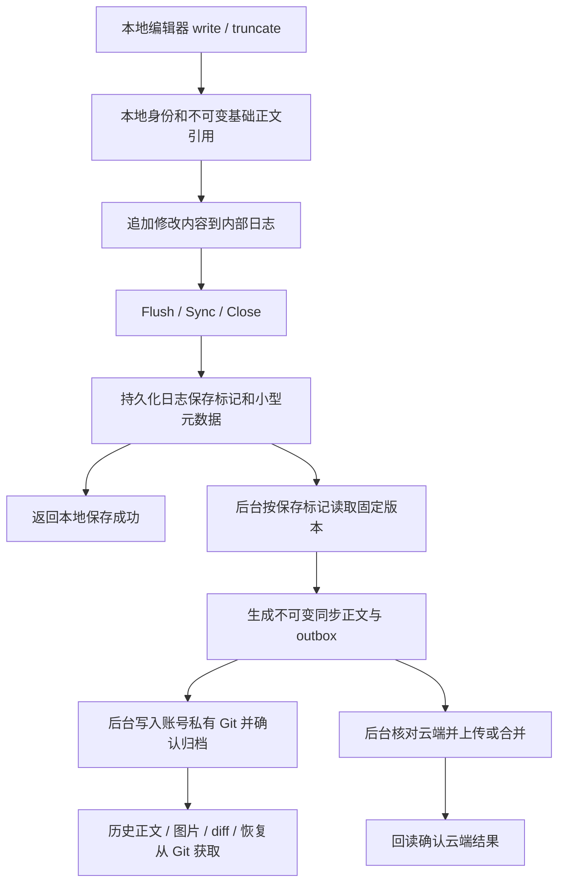

# 本地保存、Git 归档与云端同步

本轮对应需求：保存不等待整文件哈希、复制及补下载；已归档正文和资源从 Git 获取。

## 实际保存路径

首次写入仅进行本地目录与权限检查、恢复编辑器安全保存的文件身份、持久化基础正文引用。之后 write/truncate 只追加修改数据。保存时持久化日志和保存标记，不遍历正文、不启动 Git、不上传、不补下载远端内容。重复 Flush 没有新增修改时不重复生成版本。

日志期间缓存文件作为不可变底稿，读取由底稿、追加的数据区间和显式零区间组成。未缓存的旧内容必须来自已持久化的基础正文，不能把未知区域当成零；截断后重新扩展的区域才为零。每个成功保存有独立的区间视图，后台哈希期间后续编辑可继续。

## Git 的职责

- 新归档的正文、图片和二进制资源全部是 Git blob，提交树直接引用这些对象。新记录不再另存一套 `history/objects` 原始正文。
- 通过可重建索引维护 SHA-256 到 Git OID 的映射。同一内容已经归档时直接复用 Git 对象，不重新从同步缓存读取并导入。
- 历史查看、历史差异和恢复以账号私有 Git 为来源。大正文流式读取，不经过元数据命令的 32 MiB 输出缓冲限制；界面的文本预览与 diff 仍保留原有大小上限。
- 旧历史的 Asset 引用继续可读。不会为了本轮升级批量重写已有历史或下载云端文件。
- Git 尚未完成归档时，修改日志或同步 Store 的持久化正文负责恢复。同步 Store 仍承担活动上传、合并及回读核验；不会把 Git 命令放回编辑器保存路径。
- Git 提交和引用持久化后才能确认归档。图片也进入提交树，因此 Git 回收不会把仍属于历史版本的图片当成不可达对象。

## 恢复和生命周期

日志记录包括版本头、write/truncate、保存标记和 outbox 确认；每条记录校验自身头部与数据。校验只处理追加内容，不扫描整文件。启动恢复只使用有效保存边界，未提交的残缺尾部可截去，已提交部分损坏则拒绝自动丢弃并保留恢复材料。

基础正文引用和对应文件的本地保存占用状态持久化到 Store，跨进程重启保护正文及比较基线。云端刷新、删除观察和同名 Token 绑定不能越过尚未交接的本地保存。未确认的旧保存不能在重启后倒序重新覆盖已确认的新保存。

后台交接完毕且文件不再打开时，重新生成可清理的正文缓存并退休日志；所需内容仍由同步 Store 和待归档历史引用保护。清理、移除挂载和升级继续遵守未上传、未归档及冲突保护。停止 VFS 时取消并等待日志工作线程退出，再关闭 Store。

首次使用新日志将相关 Store 的读取版本提高到 3。当前实现兼容旧 1/2 版 Store，并保持 3 版不会在重开时降级；旧应用会拒绝 3 版，避免把不可变底稿误当成完整修改文件。

## 状态展示

“本地已保存”由保存标记的持久化状态决定，不再等同于“后台已生成待上传版本”。后台失败时，管理页显示具体文件、本地保留状态、检查磁盘空间/缓存目录权限及自动重试的说明。云端确认仍是独立状态。

## 保留的边界

- 原子重命名覆盖、删除等 namespace 操作仍需把相关本地保存交接为完整不可变快照，之后才能提交事务。它们可能等待本地正文整理，不能承诺所有编辑器原子保存均为零等待。普通 Flush/Sync/Close 已脱离这条同步交接路径。
- namespace 事务持有后台归档排他预约，覆盖 Begin 后的快照交接、缓存发布和 Finish，避免线程继续导入旧路径。缓存重新落盘还会核对路径没有改变。
- 旧版遗留的脏缓存首次交接和没有实现不可变本地快照接口的 Rclone 后端继续使用旧路径。原生 Rclone 命令行为不变。
- 这是源码改动，未替换本机已安装应用，未生成新安装包，未进行 Windows 驱动挂载实机验证。

## 验证依据

针对性回归覆盖：后台阻塞期间保存、连续版本、局部写入、截断/扩展、保存失败、重启、残缺尾部、已提交损坏、确认记录重放、基础正文跨重启回收保护、新文件归档失败后读取、连续编辑器安全保存、远端刷新/删除基线保护。

Git 测试覆盖二进制、超过 32 MiB 的流式正文、同内容对象复用、图片在 Git GC 后可读，以及损坏检测。相关模块、并发检测、前端测试与 Windows 交叉编译结果保存在本地 `.superpowers/local-save-20261113/`，该目录不提交。
